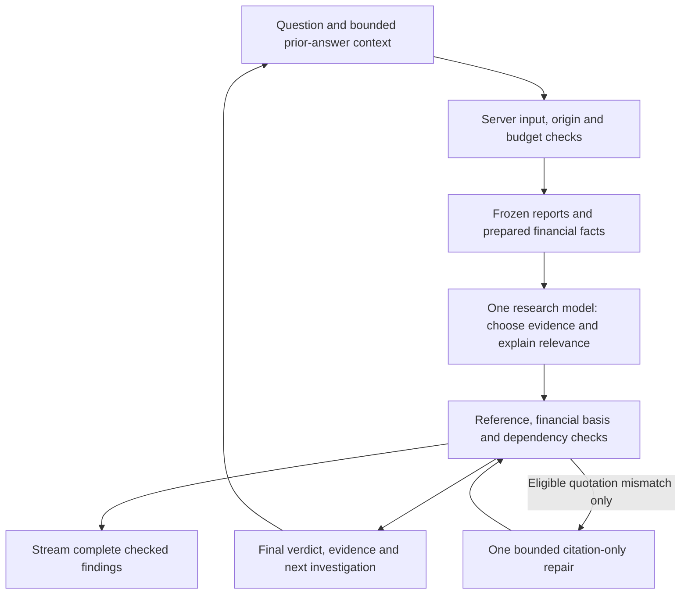

# Research Agent

A financial research prototype that helps an analyst pressure-test an investment thesis against earnings reports, inspect the evidence, and ask deeper follow-up questions.

**[Try the live demo](https://research.helenshim.me)** · [Portfolio](https://helenshim.me)

Built by Helen Shim with GPT-6 Astra and GPT-6.1 Sol. The deployed research workflow uses GPT-6.1 Sol with low reasoning effort; Astra and Sol also supported product, design and implementation work.

## What it does

Start with a public-company question such as:

- Does NVIDIA’s latest report strengthen or weaken the case for durable operating profitability?
- Why did cash flow fall while profits increased?
- How does NVIDIA’s non-GAAP treatment of equity gains and stock-based compensation affect its earnings comparison?

The agent selects relevant evidence, streams complete findings after reference checks, and publishes a final verdict only when its supporting dependencies pass. Follow-ups use bounded conversation context and should add a new comparison, mechanism or implication rather than repeat the previous answer. A suggested next investigation is user-triggered and restricted to the available evidence.

**Current coverage is deliberately narrow:** the bundled, frozen NVIDIA FY2027 Q2 and Q1 SEC earnings releases, with a source cutoff of October 11, 2026. “Latest” means the latest report in that packet, not live market coverage. The app does not fetch new sources during a research request.

## Architecture



| Responsibility | Owner |
| --- | --- |
| Intent, evidence selection, interpretation and proposed follow-up | Model, within the supplied report scope |
| Reported figures, period/unit/GAAP matching and necessary derived comparisons | Deterministic code with source lineage |
| Allowed tools, request limits, cancellation and publication checks | Controller and verifier |
| Shared deployed model-call allowance | Server-only Redis counters; separate Preview and Production pools |
| Thread history | This browser’s local storage; restored answers are revalidated |

This is one bounded researcher, not a multi-agent system. It normally completes in one provider call. At most two provider calls, two tool calls and one tool round are allowed within a 120-second controller deadline. A qualifying citation repair uses the remaining second call; it does not change claims or weaken checks. Sources stay fixed. A failed or stopped attempt preserves previous checked answers.

Matching source-reported figures and growth rates are reused directly. Code calculates missing comparisons only when needed, distinguishes reported from derived provenance, and surfaces discrepancies. Exact quote/reference matching is a mechanical check, **not proof that an interpretation is financially sound**.

Key implementation: [controller](src/lib/v3-controller.ts), [provider](src/lib/v3-provider.ts), [verifier](src/lib/v3-verifier.ts), [financial facts](src/lib/v3-financials.ts), [server boundary](src/lib/v3-server.ts), and [thread UI](src/components/a3/v3-session.tsx).

## Evaluation and learnings

The latest release checkpoint passed **179 automated tests**, TypeScript validation and hosted builds. The suite covers financial periods/provenance, reference and dependency failures, bounded repair, streaming ownership, Stop/retry, history restoration, sensitive-input handling and budget isolation.

| Live release sample | Completion | Outcome |
| --- | --- | --- |
| Durable operating profitability | 29.0 seconds | Five checked findings, complete answer |
| Executed equity-gains follow-up | 19.6 seconds | Added a distinct accounting explanation |
| Previously failing non-GAAP question | 16.1 seconds | Complete answer, two checked findings |
| Client cancellation | About 2.9 seconds | Provider cancelled; attempt stopped |

These are small release samples, not a p95, a reliability guarantee or proof of superiority over ChatGPT. Later custom-domain verification completed in 29.8 seconds with five checked findings. The supplied ChatGPT comparison used additional web sources and is not a matched benchmark.

Important product learnings:

- A verdict needs evidence-weighted explanation and material counterevidence; a shorter summary alone is not enough.
- Streaming checked findings improves perceived progress without presenting an unchecked final verdict.
- Suggested follow-ups must be both answerable and additive. Reusing a topic is useful when the new answer provides a deeper distinction.
- Unsupported causal questions should produce a precise evidence gap rather than adjacent, stale facts.
- The latency experiments did not establish a reliable speed gain, so their experimental transport option stayed off.

See the [evaluation rubric](evals/prototype-3/EVALS.md), [release smoke results](evals/prototype-3/PRODUCTION-SMOKE-2026-10-13.md), [latency experiment](evals/prototype-3/LATENCY-2026-10-13.md), [continuation checks](evals/prototype-3/CONTINUATION-2026-10-13.md), and [decision log](docs/DECISIONS.md). Helen confirmed one buy-side participant could access the app and supplied feedback; no new independent numerical score is claimed here.

## Run locally

Requires Node.js 24.

```sh
npm ci
cp .env.example .env.local
# Set OPENAI_API_KEY in .env.local using your local editor.
npm run dev:v3
```

Open http://127.0.0.1:3006/v3. An API key with billing is required for live answers. Never paste keys into a question or commit an environment file. Local development uses a process-local $10 ledger; it resets with the process and is not a durable production spend control.

```sh
npm test
npm run typecheck
npm run build
```

Some older source-acquisition/integration cases depend on ignored local fixtures; read their skip conditions when reproducing historical checks. Bundled report text and prepared facts support the current V3 workflow without a new SEC download. Optional acquisition scripts require an identifying `SEC_USER_AGENT` and obey the documented SEC source policy.

For Vercel deployment, configure server-only `OPENAI_API_KEY`, `KV_REST_API_URL` and `KV_REST_API_TOKEN`. Production live research also requires `V3_PRODUCTION_LIVE_ENABLED=true`. Keep the flag off until your own release checks pass. Default deployed allowances are separate $10 totals per environment, with atomic reservations; unknown usage remains charged conservatively and Redis failures block new paid calls. The allowance is separate from OpenAI credit balance and is not a cap on hosting costs.

## Scope and safety limits

- No live prices, news, transcripts, valuation, forecasts, other-company coverage or scheduled monitoring.
- No buy/sell advice, suitability assessment or client/account data. Recognized sensitive patterns are blocked; detection is not exhaustive.
- Server-only credentials, `store:false` provider requests and public research context do not establish firm compliance or a zero-retention guarantee.
- Browser history is device-local and may contain your research text. Clearing history removes local saved sessions; there is no cross-device account sync.
- A public demo can stop accepting new research when its shared allowance runs out. Existing checked answers remain available.

## Product history

V1 explored structured investor inputs. V2 pivoted to open questions and contextual investigation. V3 added richer evidence-backed synthesis, incremental findings, more useful continuation and a public portfolio demo.

The original local V3 baseline is tagged `prototype-3-baseline-2026-10-13`. Historical docs describe their checkpoints, including old protected URLs and earlier scopes; the live README and later decisions describe the current release. See the [V1 → V2 memo](docs/prototypes/prototype-2/V1-V2-PRODUCT-DECISION-MEMO.md), [V3 plan](docs/prototypes/prototype-3/PLAN.md), and [baseline record](docs/prototypes/prototype-3/V3-BASELINE.md).

## Public-repository audit

Before publication, every reachable branch/tag and historical blob was checked for credentials and private-data indicators. Results and limitations are recorded in [the publication audit](docs/PUBLICATION-AUDIT.md). Ignored local credentials, deployment authentication state and generated research captures are excluded. Public-company evidence and clearly synthetic privacy-test fixtures remain included.

Bundled fonts retain their upstream notices in [public/fonts](public/fonts). No license for Helen’s original code is granted by those font notices.
