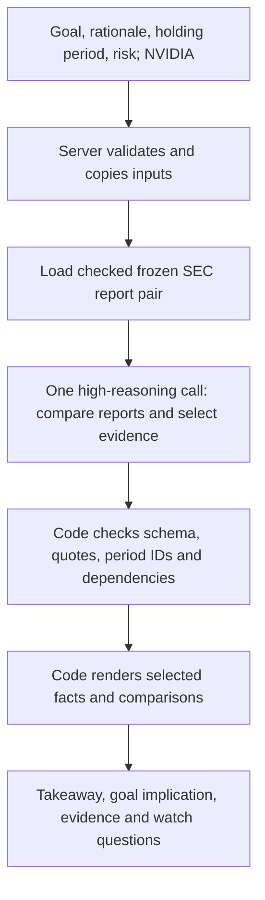

# PRD: Portfolio Research Agent (working name)

Owner: Helen Shim · Status: v0.58. Prototype 1 frozen; V2 local baseline preserved; Prototype 3 richer thesis-analysis and reported-first evidence contracts implemented locally; live V3 output testing blocked by provider-reported exhausted credits; semantic/pilot gates pending · Last updated: 2026-10-12
Build tool: Codex, on OpenAI models.
Decision log: `docs/DECISIONS.md`. Every decision is logged there, and the affected PRD section is updated in the same change.
Prototype history: `docs/PROTOTYPE-VERSIONS.md`. Prototype numbers describe product experiments, independently of PRD revision numbers. Prototype 1 is preserved at Git tag `prototype-1` with its exact deployed source and original protected Preview. V2 is preserved at `prototype-2-baseline-2026-10-12`; current local experiments are on `prototype-3`, not a released prototype. Start the next iteration with the learning review and task validation in `docs/prototypes/prototype-2/PLAN.md` before expanding scope.

---

## 0. Why I'm building this

I need to show that I can do the job of a Product Manager, Financial Services at OpenAI:
- find a real problem in a financial workflow
- prototype an agent with OpenAI models and Codex
- define what "good" means for professional financial work
- measure it and improve it from evidence

The same work should also be good evidence for Google DeepMind's PM, New Consumer Verticals role, which covers consumer personal finance, agent design, and evals. And it should be useful enough that I use it on my own portfolio.

The problem comes from my own experience. As a Wealth Management analyst at Morgan Stanley, I printed Morningstar reports and manually checked holdings, profiles, and spreadsheets across tools that didn't talk to each other. I want to build the agent I wish I'd had.

**Order of priority for every decision:** (1) OpenAI FinServ PM evidence, (2) DeepMind NCV evidence, (3) personal usefulness.

## 1. Problem

### Problems at a glance

1. **Coverage exceeds capacity.** More companies and documents to follow than hours available.
2. **Relevance to my context.** Finding the changes that matter to my thesis or my client's goals.
3. **Verification tax.** Unverified AI output adds checking work.
4. **Fragmented tools.** Information lives across terminals, filings, spreadsheets, and PDFs. The human becomes the integration layer, copying and cross-checking by hand.
5. **Privacy and compliance, a constraint.** Sensitive client data limits which tools firms can use, blocking automation where client context would be most valuable.

These problems lead to the product's core approach: join the sources, interpret them for the client, verify the evidence, and minimize the client data required. The context model below explains why the problems occur; the practitioner questions test whether they still hold today.

### Root cause: context is fragmented

Good financial research depends on context. Our hypothesis is that fragmented context, evidence presentation and review work are major bottlenecks alongside model limitations. Source completeness, task design and reasoning quality must be tested separately; we have not established that model capability alone is sufficient.

| Context | What it is | Where it lives today |
|---|---|---|
| Company | Filings, earnings, financials | Terminals, SEC EDGAR, PDFs |
| Market | Peers, trends, what funds own | Bloomberg, Morningstar, news |
| Client or investor | Goals, risk tolerance, constraints, history, thesis | CRM, notes, the advisor's head |
| Firm | House views, approved lists, compliance rules | Internal docs, compliance systems |
| Output | Where the work ends up | Excel, decks, client emails |

### Symptoms

1. **Coverage exceeds capacity.** People follow more companies and clients than they can read and connect by hand.
2. **Generic output.** Without client context, AI tools give everyone the same answer, so the professional still has to translate it for each client.
3. **Verification tax.** Context joined by hand gets re-checked by hand. Unverified AI output adds checking work instead of removing it.
4. **Swivel-chair workflow.** Copying, printing, and cross-checking across several tools to answer one question.

### The catch

5. **Privacy and compliance.** The most valuable context, client data, is also the most sensitive and regulated. Firms restrict how tools can access and process it, which can prevent automation where client context would help most.

**The central design tension:** the agent needs client context to be valuable, but firms must control how that context is exposed and processed. The product has to solve both at once.

### Problem statement

Doing financial research well depends on context: the company's filings, the market around it, and the client's or investor's goals. That context is spread across terminals, filings, spreadsheets, CRMs, and people's heads, so the analyst becomes the integration layer, joining and re-checking it by hand. AI summaries don't fix this. Without client context they're generic, unverified output adds checking work, and the most valuable context, client data, is the hardest to use safely.

### Assumptions to validate

- My experience is about 6 years old. Excel AI and connectors have improved since then, so fragmentation may be partly solved. Ask practitioners: "How many tools do you touch to answer one question about a company or client? What do you still do by hand?"
- Advisors mostly rely on firm research rather than researching individual stocks. Their pain is translating events to each client and preparing for meetings.
- Verification time is a large share of total research time.

## 2. Users and their problems

**Prototype 2 direction (D61):** Financial analysts/equity research professionals expressing company research objectives are the first V2 exploration. The proposed job is to ask a question, inspect a source-backed answer/artifact and continue with a contextual follow-up. This changes the advisor-first D60 starting hypothesis; the table below records the shipped Prototype 1 task and its separate validation tracks. V2 data/task limits remain subject to the concrete plan approval, not a claim of general analyst coverage.

| Priority | User | Immediate job | What a useful MVP delivers |
|---|---|---|---|
| Primary, first MVP task | Wealth advisor who discusses individual-stock holdings | Prepare a defensible explanation of an earnings report before a client conversation | A concise update tied to supplied goals and holding rationale, selected financial/qualitative evidence, material qualifications and a useful watch question |
| Primary target, separate validation track | Buy-side analyst | Check developments against a specific holding premise and identify the next investigation | Evidence supporting or weakening the premise; current bounded inputs demonstrate a narrow premise check, not a complete professional thesis/valuation update |
| Personal use | Helen, self-directed investor | Understand whether reported developments support the reason for owning a company | An evidence-linked explanation with explicit unanswered questions |
| Later exploration | Other analyst/VC discovery workflows | Broader company research or discovery | Not a first-release promise |

The advisor goes first because the bounded holding-explanation task fits the approved inputs and one-company source scope. Buy-side fit must be tested separately; broader goals and an enum rationale do not capture analyst expectations, models or proprietary theses. No role selector or additional input is introduced by this positioning change. Audience needs and actual time saved remain hypotheses.

## 3. Goals

**Prototype 2 goal (D61):** Reduce the work of expressing, refining and verifying a financial research question through intent-driven research and a reusable evidence-backed artifact. Judge task completion, first useful checked insight and citation support; conversation alone does not establish value. The shipped first-release goals below remain the Prototype 1 baseline.

**MVP user goal:** “When a stock holding reports earnings, help me explain the developments relevant to the supplied goals and reason for owning it, with the evidence and a clear question to keep watching.”

**MVP product goal:** Help wealth advisors prepare a concise, evidence-backed explanation of one stock holding after earnings by connecting the complete approved earnings release and code-owned financial facts to the supplied goal, holding rationale, holding period and risk tolerance. Select the figures and qualitative evidence that support or qualify the takeaway, and identify a concrete unresolved/watch-next question. Test whether this reduces total preparation, checking and editing effort relative to existing research.

**Analyst validation goal:** Test whether the same evidence-linked premise-check approach helps buy-side analysts perform an initial earnings review. Do not claim full thesis coverage, investment suitability, valuation or alpha.

**Longer-term vision:** Extend the validated workflow to persistent watch items, next-filing checks, bounded follow-up investigation and relevant portfolio/firm context. Broad company/market/client integrations remain a roadmap, not an MVP capability.

**Success measures:** total time to a review-ready explanation (generation + source checking + editing); supported factual/interpretive claims and material omissions; substantive rewriting; relevance to actual practitioner questions; and usefulness of the next research step. Source-opening frequency alone is not success: inspecting evidence can be appropriate.

**Demo moment:** One input configuration produces a ticker-first takeaway, qualitative business explanation, selected financial rows and an unanswered/watch-next question with expandable sources. One-company runs compare context sequentially behind the scenes; no A/B selector or forced differing conclusion. Demonstrate actual checked behavior, then evaluate usefulness against manual/ChatGPT workflows.

## 4. Evidence this project must produce

The hiring manager evaluates whether I can run the PM loop, not the product itself. Each row comes from the OpenAI JD.

| JD asks for | Evidence this project produces |
|---|---|
| Build working prototypes with Codex and OpenAI tools | A deployed agent built in Codex on GPT models |
| Sit with customers and learn the data they trust | Notes from 3-5 practitioner sessions (Stern IB friends, a wealth advisor) |
| Bring together models, financial data, and enterprise knowledge | MVP joins issuer release text, code-owned SEC facts and bounded goal/rationale inputs; broader market/firm context remains roadmap |
| Translate integration, data-access, privacy, and review requirements into product decisions | Data minimization by design, an audit trail, and logged privacy tradeoffs |
| Turn real tasks and failures into evaluations | Source-based tests, practitioner task reviews and failure records; in-product feedback controls are later scope |
| Define good across accuracy, traceability, completeness, ease of review | Automated citation checks and a published accuracy score |
| Tell a model limitation from a data, workflow, or design problem | Every failure tagged by cause: model, data, workflow, or design |
| Measure task completion, output acceptance, time saved | Useful / Not useful / Wrong rates, time to trusted answer, verification tax |
| Tradeoffs across quality, latency, reliability, cost | Logged model choices with cost and latency per run |
| Judgment on trust and accuracy in consequential work | Decision support, not advice (section 5) |

## 5. Product principles

1. **Context guides relevance.** Consider all inputs and change selection/implications only when justified. Identical evidence can warrant the same conclusion across profiles; cosmetic differences are not evidence of personalization.
2. **The agent is the integration layer.** It pulls from multiple sources, cross-checks them, and returns one view, so the user isn't the one joining tools.
3. **Every claim is traceable.** Use source-reported financial figures and comparisons when their period, units and accounting basis match the question; code calculates only needed missing comparisons and preserves their input lineage (D87). Quotes are checked word for word against the source by code. Anything unverifiable is dropped and counted, never shown as fact.
4. **Privacy by data minimization.** The MVP collects only a ticker, goal, holding period, risk tolerance and bounded holding rationale. Portfolio weights, detailed needs and constraints remain later scope. It never collects or sends names, emails, account numbers, or other direct client identifiers. Holdings and goal parameters are processed server-side and sent to the model. This minimizes identity exposure; it does not establish anonymity or firm approval.
5. **Reviewable by compliance.** Every brief carries its sources and a record of what the agent did and which data it used.
6. **Decision support, not advice.** Explain evidence supporting, challenging or leaving the supplied holding rationale unresolved. No buy/sell recommendations, target allocation or implied suitability/valuation judgment.
7. **Make limits specific.** Distinguish future uncertainty, absent disclosure, conflicting evidence and retrieval gaps. Report unchanged measures only when actually compared; evaluate material omissions without forcing a long report.

---

## 6. What it must be able to do

**MVP job: prepare an individual-holding earnings explanation.**

1. Accept the approved bounded inputs for one company; validate and freeze them for the run.
2. Retrieve the complete approved earnings release and structured financial data, preserving source dates, table headings and calculation lineage.
3. Review the source in full; select a material takeaway tied to the supplied context, including evidence that qualifies or challenges it.
4. Show what happened, what it means for the supplied goals/rationale, and what remains unanswered or should be watched.
5. Select up to three eligible financial rows that explain the takeaway; render labels, code-owned values, units and comparison bases. Include attributed qualitative evidence and material qualifications.
6. Provide a brief advisor discussion point derived from the same supported evidence; no separate synthesis model call or mandatory three-item talking-point list.
7. Expose exact source links, precise mechanical checks, unresolved data and run/retry status. Checks do not certify interpretation support.

**Later jobs:** saved watch items, next-filing comparisons and adaptive follow-up, then additional portfolio/thesis/firm context validated against user tasks. Discovery and ongoing market monitoring are not part of the initial job.

## 7. Scope by milestone

**Prototype 2 current scope (D61–D84):** open-ended questions, contextual same-session follow-ups and source-backed structured answers/artifact; optional suggestions rather than required goal/risk/rationale selections. Basic truthful status/errors remain required. Sources are the frozen NVIDIA report pair with code-owned financial facts, GAAP operating margin and the fixed cash bridge. D82 promotes independently checked findings and actual animated stage updates from the original P1 recommendation into the current build: publish complete findings as their mechanical checks pass, then reconcile against the complete checked answer. D83 makes that event extension opt-in so already-open older clients retain their supported stage/result protocol. D84 folds action-history expansion into the one current-action/status row. Selective clarification remains later work. Multi-agent orchestration, complex memory, broad sources/forecasting and cross-session persistence are deferred or unresolved. See `docs/prototypes/prototype-2/V1-V2-PRODUCT-DECISION-MEMO.md` for the original pivot. The milestone table below documents earlier release/roadmap scope; later decisions govern current V2 behavior.

| Milestone | In | Out |
|---|---|---|
| **MVP, first release (D57)** | One sample configuration; approved editable goal, rationale, holding period and risk; NVIDIA only; two complete frozen SEC earnings releases plus code-owned facts; high/context-v1 synthesis; takeaway, paired business developments, up to three selected supporting/qualifying metrics, up to two watch questions, discussion point and inspectable evidence; compact responsive Next.js UI; protected Vercel Preview. | In-app gate/login, A/B client selector, other-company web coverage, full personal portfolio/thesis entry, live SEC refresh, prices/news/consensus/valuation/external macro, scheduled monitoring, adaptive tool loop, persistence, exports, firm integrations and public paid access |
| **V1, prioritized research continuation** | Saved evidence/watch baselines, user-triggered next-filing checks and bounded adaptive follow-up (D35/D51), with source lineage and useful unresolved stops. Additional input/context only after task validation. | Unrestricted browsing or automatic expansion to licensed sources |
| **Later roadmap** | Full personal portfolio context, drift analysis, feedback controls, exports, discovery, risk-factor comparison, market/firm integrations and scheduling, prioritized from user evidence. | No automatic commitment to all roadmap items for the next release |
| **Never** | Source-linked research and reviewable limitations | Buy/sell recommendations, target allocations, specific buy-this tickers, client identity collection |

**Sample client (no identity):** retiring in 3 years, income focus, low risk. No client selector in MVP.

**First-release web coverage (D57):** NVDA only, shown directly. Local source/CLI experiments retain NVDA, AAPL, JPM, COST and JNJ; those are not additional web coverage. Multi-holding research remains deferred.

**Evaluation-only comparison:** retain a long-horizon, growth-focused, high-risk goal fixture with AI interest for controlled context tests. This is not a second client in the user flow.

**Data realism (D27):** use real public SEC company data from the start. The sample client uses illustrative goal parameters, not a real client record. Switching from presets to user-entered goals in V1 increases realism; it does not itself establish that the model uses context well.

**Context-validation sequence (D26):** test the sample goals and an evaluation-only alternative against identical holdings and company-source snapshots during MVP evaluation. The UI does not need to show both at once or run both automatically. In V1, use a user-entered goal profile, including Helen's own if desired, and compare with a controlled variation of a goal parameter on the same source snapshot. Evaluate justified differences in implications while requiring consistent company facts. Treat context sensitivity as a hypothesis until supported by evaluation results.

**Cut list if behind** (cut in this order):
1. feedback buttons: cut from MVP, approved under D22
2. full personal profile entry: deferred; bounded MVP research controls restored under D30
3. portfolio drift flags: cut from MVP, approved under D22
4. multi-holding research: already narrowed to one company per run under D43

**Never cut:** the verifier, sources, or the ability to test the same company data against different profiles. Context testing can happen through sequential runs and evaluation; simultaneous display is not required (D25-D26).

### Follow-up research roadmap (D35)

Helen explicitly requested a later workflow that checks new filings against saved watch items and supports further research prompted from results. This is a roadmap commitment, not a background task created now or an implemented MVP capability.

- MVP output design should make watch items actionable: ticker, research question, original evidence/period, relevance to goal and holding period, concrete observable signal, and evidence that would strengthen or weaken the interpretation. Exact schema remains part of the output contract.
- First follow-up increment: explicitly save a watch item, then user-trigger Check new filings. Retrieve approved SEC sources, align reporting periods and metric definitions, compare with the saved baseline, and return strengthened / weakened / unresolved with evidence. No new relevant filing must be distinguished from a filing that does not answer the question. No threshold or probability invented by the model.
- Enable targeted follow-up prompts from a result, such as Explain this uncertainty or Check whether this pattern persisted. Each becomes a bounded research task tied to the result’s sources and input configuration, with approved tools, retrieval/cost limits, verification, and visible unavailable-evidence states. Requests outside coverage must be explained rather than answered without evidence.
- Later automation: scheduled checks after relevant filings, deduplication, versioned watch items, and notifications only for meaningful evidence changes. Define notification preferences and retention/access controls before enabling persistence or scheduling. No scheduling or messaging is authorized by this roadmap alone.
- Acceptance criteria: correctly identify relevant new evidence, maintain baseline/source lineage, justify update status, avoid unsupported causal/forecast claims, and reduce follow-up effort in practitioner tests. Record false alarms, missed updates, retrieval failures, and useful follow-up completion.

Full problem-gap assessment and implementation order: docs/MVP-GAP-ASSESSMENT.md.

## 8. How it works

### Data sources

**MVP access rule (D23):** exclude any research data source that requires an extra login, paid subscription, or credentialed connector to obtain its data. Use public SEC research endpoints and filing documents. Public access alone does not establish reliable application access or extraction quality; verify both at the data checkpoint. OpenAI and Vercel credentials are infrastructure setup, not research-source logins.

**SEC acquisition and reuse requirements (D24):**
- Use official public research APIs for metadata and financial facts, plus targeted downloads of filing indexes and EX-99.1 documents. SEC permits scripted access and reuse of public EDGAR filing content. HTML parsing of a downloaded exhibit remains subject to the same access rules; API access alone does not establish compliance.
- Send the configured `SEC_USER_AGENT` identifying the application and an operator contact on every SEC request, including retries and permitted redirects. Stop before retrieval if it is missing. Never use client identity in this header.
- Set a conservative aggregate budget of at most 5 SEC requests per second, including retries, across workers and application instances. Cache and deduplicate company-source retrieval across profiles. A separate in-memory limiter in each Vercel instance is insufficient to establish aggregate enforcement.
- Honor `Retry-After` when provided for rate limiting; use bounded backoff for transient errors. On an access-denied block, stop and surface source unavailability. Do not rotate identities, use proxies to evade blocks, solve access challenges, or bypass authentication or paywalls.
- Restrict retrieval to the planned official SEC endpoints and SEC filing URLs. Reject redirects to unapproved hosts; do not silently fall back to issuer sites, transcript vendors, or financial aggregators without reviewing their access and reuse terms.
- Cite the original filing and preserve reporting period, accession, retrieval time, and source hash. Display concise evidence excerpts. Do not use SEC seals or logos or imply SEC affiliation or endorsement.
- Before shipping, verify headers, aggregate request pacing, cache reuse, retry limits, permitted destinations, and access-denied behavior. Record test results. These requirements follow SEC's published policies; they are not a claim that an unimplemented fetcher or the whole financial product has been legally certified.

Policy references reviewed on 2026-10-11: [SEC research APIs](https://www.sec.gov/search-filings/edgar-application-programming-interfaces), [scripted access and public-filing reuse FAQ](https://www.sec.gov/files/about/webmaster-faq.htm), [SEC privacy, security, and dissemination policy](https://www.sec.gov/about/privacy-information), and [EDGAR access guidance](https://www.sec.gov/search-filings/edgar-search-assistance/accessing-edgar-data).

Starting point: the MVP needs company numbers and management commentary. New risk-factor analysis remains later scope. Actual application retrieval and initial fiscal-aligned packet generation succeeded on 2026-10-11 for all five supported holdings. Tests cover the representative NVDA/JPM/COST packets. Deployment-origin acquisition and aggregate enforcement remain prerequisites for future live SEC retrieval; D57 serves already acquired snapshots and performs no runtime SEC requests. Results: docs/checkpoints/SEC-DATA-2026-10-11.md.

| Source | Gives | Accessible | Verdict | Reasoning |
|---|---|---|---|---|
| **SEC XBRL company facts** | Exact reported numbers | Free JSON, no key, User-Agent header required | **MVP: the number anchor** | Official structured data. Select issuer-specific fiscal periods and current metric concepts, not a universal ~90-day filter. NVDA quarter and YTD values share an end date; Costco Q4 spans 16 weeks. Arrives with the 10-Q/10-K. |
| **8-K earnings release (EX-99.1)** | Headline results, guidance, management narrative | Free. Find it via the filing index row "Type = EX-99.1" (filenames vary; NVDA's is `q2fy27pr.htm`). About 22K characters of text. | **MVP: the "what changed" narrative** | Report-day timing. Company-written, so the verifier and "evidence for trimming" offset the spin. |
| 10-Q/10-K text (risk factors, MD&A) | New risks, language changes | Free | V1 | Long and fragile to parse |
| Earnings call transcripts | Q&A, tone | Licensed | Not in v1 | Licensing risk |
| Prices and analyst consensus | Beat vs. miss, valuation | Paid | Not in v1 | The connector gap OpenAI addressed with LSEG, PitchBook, and Daloopa. The MVP compares to prior periods, not consensus. |
| Web search | News and reactions | Costs per call | V2 | Paywalled pages can't be checked word for word |
| 13F holdings | What big funds own | Free, ~45-day lag | V2 Discover | |

**Cross-source check:** when the release and the structured data report the same figure, the brief identifies a consistency check between two issuer-provided formats; this is not independent corroboration. Example verified live: the NVDA release says "revenue of $96.2 billion" and XBRL says 96,221,000,000.

### MVP user flow and UI (D54 supersedes stale flow descriptions)

1. Open directly on NVIDIA with approved income / dependable-income / short / low defaults. Edit goal, holding period, risk and rationale. No in-app gate/login or client A/B selector. Vercel owner authentication protects the early preview.
2. Select Generate brief. Server validates and freezes the displayed configuration.
3. Show actual source preparation, full-report analysis and mechanical checking stages. Do not display unverified streamed claims or invented progress.
4. Show ticker/company/period first, then a context-specific takeaway and business explanation. Supporting rows separate evidence labels, values/comparison bases and implications; include material qualifications.
5. Show a concrete unanswered/watch-next question and one concise discussion point for advisor review. These reuse the supported evidence; they do not establish client goal attainment.
6. Expand source excerpts, calculation basis and run details. Show unavailable evidence and targeted retry for the one-company run.
7. Bind results to original inputs/source cutoff. Follow-up prompts can be described as roadmap research questions; do not show a working adaptive button until implemented.

Responsive Next.js UI is implemented and deployed to a protected Vercel Preview (D57). The server uses the paired full-release path with no keyword lookup. Live deployed verification completed: income/short/low/dependable-income case, 131 seconds; headline/core findings survived, two comparative items removed. Analyst validation uses separate tasks, not a role-specific UI.

### Research input semantics (D30-D32)

**Primary goal question:** What is your primary investment goal?

Use these option labels and descriptions word for word. Descriptions may appear as optional subtitles; placement will be decided in visual design. Research emphasis is context for analysis, not a promise of complete coverage or an investment recommendation.

| User-facing option | User-facing description / optional subtitle | Research emphasis |
|---|---|---|
| Generate ongoing income | I want my investments to provide recurring cash payments. | Dividend sustainability, cash generation, payout changes. |
| Grow my investment value | I want the value of my investments to grow over time. | Growth drivers, reinvestment, margins, durability. |
| Protect money for a planned need | I want to preserve money I expect to use for a future expense. | Business stability, financial resilience, uncertainty. |

Default primary goal: Generate ongoing income. Goal and risk tolerance are separate: the goal describes the desired outcome; risk tolerance describes accepted uncertainty. These parameters guide prioritization and interpretation of supported company evidence, not changes to reported facts or buy/sell recommendations. Missing evidence must remain visible rather than filled in to satisfy a goal.

**Holding-period question:** How long do you expect to hold these investments?

**Helper text:** Choose your intended holding period. This helps us put company developments in context.

| User-facing option | User-facing description / optional subtitle | Research emphasis |
|---|---|---|
| Short term: less than 3 years | I’m evaluating these investments over the next few years. | Recent performance, near-term business developments, and uncertainty. |
| Medium term: 3–10 years | I’m giving these investments several years to develop. | Whether current changes affect sustained performance and business durability. |
| Long term: more than 10 years | I’m investing across business cycles. | Durable growth drivers, competitive position, and structural risks. |

Default: Short term: less than 3 years. Boundaries: less than 3; 3 through 10 inclusive; more than 10 years. One intended holding period applies to the selected company in MVP. Goal describes the desired outcome, holding period describes expected ownership duration, and risk tolerance describes accepted uncertainty. Holding period does not mean speed of returns, withdrawal timing, or a model forecasting window. The task remains latest-earnings research against prior periods, not short-term trading research. The agent uses holding period to prioritize and contextualize supported findings without altering company facts, inventing forecasts, or ignoring near-term risks for long-term investors.

### Release positioning and freshness (D34)

Ship a verified earnings-based portfolio research brief first, not a daily market monitor. Daily/weekly prices and broad news research are out of the first release. At the data checkpoint assess a small recent SEC filing activity indicator from existing metadata; it is optional and not a release dependency. A later bounded recent-event investigation workflow can select and investigate relevant newer evidence from approved sources.

For financial changes, use latest quarter versus the same fiscal quarter a year earlier as the primary baseline; prior-quarter context only where comparable. Latest-release commentary is a current update, not a proven narrative change unless explicit comparative evidence supports it. Every result must show the evidence date/period; do not imply that an older release establishes what is happening today.

**Forward-looking output design under review:** distinguish historical results, source-backed management outlook, conditional implications, and watch-next questions. Do not invent next-quarter estimates, probabilities, price targets, or current-event claims. A public management outlook in the release may be cited as management-stated guidance only; it is not an independently verified forecast or an XBRL actual. Separate verifier rules are needed before displaying any numerical guidance. Conditional implications require checked evidence, explicit assumptions, and visible uncertainty. Watch-next items should state a concrete signal and why it matters for the submitted goals and holding period. No extra model calls or new sources are approved by this output exploration.

### Input validation and submitted configuration (D33)

- Required enumerated inputs: primary goal (`income`, `growth`, `planned_need`), holding period (`short`, `medium`, `long`), and risk tolerance (`low`, `medium`, `high`). Defaults: income, short, low.
- Web release fixes the ticker to NVDA (D57); the server rejects other companies before a model call. The local contract retains five source experiments. No weight editing or portfolio exposure calculation; this task uses the holding rationale.
- Validate on the server as well as in the UI. Reject unknown enum values, unsupported tickers, duplicates, empty selections, and multiple tickers before retrieval/model calls. Never silently replace invalid input with defaults.
- Show actionable inline errors, including Select one company. Preserve entries after failure. Prevent duplicate submissions while a run starts.
- Submit only goal, holding period, risk tolerance, one selected ticker, and the holding-rationale enum. Server assigns the fixed task `latest_earnings_review` and input-schema version. No names, ages, account identifiers, free-text personal context, or client-supplied source URLs.
- Bind each result to an immutable copy of the submitted configuration and run ID. Input edits do not change an existing brief; another explicit Generate brief action is required. Display the configuration used in the result. Retries reuse that configuration and the run’s source snapshots where available.

Example submitted input:

```json
{
  "primary_goal": "income",
  "holding_period": "short",
  "risk_tolerance": "low",
  "tickers": ["NVDA"],
  "holding_rationale": "dependable_income"
}
```

### Holding-rationale contract (D43)

Implemented and controlled-tested on NVDA with goal/period/risk held fixed. The rationale changes research questions and unresolved evidence requirements, not company facts. Expanded NVDA facts distinguish operating income from net income and cash-dividend declarations from payments. Unreconciled dividend-payment data is withheld. Details: docs/checkpoints/HOLDING-RATIONALE-2026-10-11.md.


**Question:** What are you relying on this company to do?
**Helper:** Choose the expectation you want this report to test.

| User-facing option | Premise the agent tests |
|---|---|
| Sustain profitable business growth | Demand will translate into durable earnings and cash generation. |
| Provide dependable dividend income | The company will continue cash distributions supported by its business. |
| Remain financially resilient | The business can withstand setbacks without weakening its financial position. |

Use bounded enum choices for the first version, rather than collecting identity-bearing free text. Default rationale: dependable income, consistent with the existing sample goal. Goal captures the broader desired outcome; rationale captures the role expected from this company. They need not match and must not be silently coerced. Full personal theses remain later scope.

Primary result: user rationale, what the report supports, what it challenges, what remains unresolved, concrete implication for that rationale, and the next decisive evidence. Status is supports / challenges / unresolved, describing evidence about the premise, never whether to buy, hold or sell. A source period and material uncertainty must remain visible. Partial historical evidence cannot establish long-term durability or dividend dependability. Missing decisive evidence means unresolved, not a confident judgment.

**Visible earnings evidence (D44):** Show a concise overall assessment summary and up to three material drivers directly below it. Each driver includes eligible code-owned figures, units, the comparison baseline when available, and a brief explanation connecting the evidence to the selected holding rationale. Keep decisive limitations visible; expand detailed source excerpts and calculation lineage. Minimal presentation must not hide the numbers that explain the conclusion. “Ratings” means the internal categorical premise assessment, not analyst ratings or a numerical investment score. Describe drivers of the current assessment; show movement only after storing and comparing a prior assessment with compatible inputs and evidence cutoffs. This change is documented and previewed; automatic driver selection/rendering remains to be implemented in the web app.

Model assessment must reference eligible surviving findings or research answers. If the reference chain fails or rationale ID differs from the submitted input, remove the assessment and show a neutral insufficient-evidence outcome. Deterministic checks establish lineage and fidelity, not whether the evidence entails the assessment.

Evaluation: hold company sources, goal, holding period and risk constant; vary only the rationale. Inspect question selection, retrieved evidence, conclusions and unresolved gaps. Different wording alone does not count. Existing six-case goal tests predate this contract and are not proof of the new premise-check capability.

### Existing bounded-focus baseline (D37, D43; primary direction superseded by D52/D54)

After initial approved source retrieval and code-computed financial comparisons, select at most two research questions per holding from eligible facts and the specific holding rationale plus goal/holding-period/risk context. Each question must reference fact IDs and explain relevance. No unsupported factual assertion may be presented as a research focus.

Investigate each question through an evidence lookup tool restricted to that holding’s retrieved SEC release. Return matched source passages with stable evidence IDs, not a model’s claimed lookup. Model selects question and search targets; code performs lookup; model assesses returned passages. Cap at two lookups per holding, one for each question. If nothing relevant is found, return unresolved; no open-ended searches, new sources, or retry loop. This is bounded tool use, not autonomous broad research.

Progress may show Research focus: checking cash generation, labeled as an investigation. Show only real stage activity and avoid displaying tentative conclusions before verification. Final results expose question, evidence checked, supported finding or unresolved gap, and watch-next signal. Verified fact and quote checks do not establish entailment; evidence-support evaluation remains required.

Compare this stage with a single-pass version of the same engine and a strong ChatGPT baseline. Assess answer support and relevance, not the apparent sophistication of the workflow. Keep adaptive evidence lookup only if it improves findings or reduces review work enough to justify latency and cost. Full comparison protocol: docs/CHATGPT-COMPARISON.md.

### Implementation status (D39-D57; historical CLI evaluation below)

Historical baseline evaluation: core TypeScript modules and CLI implement code-owned fiscal comparisons, actual bounded release lookup, structured planner/analysis schemas, and verifier/dependency removal. Typecheck and 26 tests pass, including reasoning-option propagation checks. Six paired API cases completed after fixing passage-ID and short-quote defects. Focus median model latency was 28.2s versus 18.6s for single-pass; a general quality advantage is not established. Evidence-support refinement and actual ChatGPT comparison remain incomplete. The D57 paired web UI and protected preview are now implemented. See evals/SIX-CASE-ENGINE-COMPARISON.md. The initial verifier permits only numerical-free narrative excerpts and code-owned financial quantities/placeholders; this conservative implementation restriction must be evaluated for excessive evidence loss. Financial period edge cases outside the tested snapshots are not claimed covered. Deployment-wide source controls remain required before runtime SEC retrieval; the frozen-source preview makes no SEC requests.

### Historical minimal presentation direction (D42; refined by D44-D54)

Helen requested outputs that are substantially simpler than a shortened financial report. Proposed default: what deserves attention, why it matters for the entered goal, and one concrete watch-next question per holding, with its evidence date. Expand figures, excerpts and research trace on demand; material uncertainty remains visible. Do not use quantity of text, arbitrary risk scores, or number of findings as evidence of value. Compare attention-list, single-signal and meeting-note designs before choosing the final UI. Backend evidence/dependency requirements remain intact. Analyst thesis input and continuous monitoring remain gaps, not implied capabilities.

### Output contract (D38)

Implementation specification: docs/OUTPUT-CONTRACT.md. Use evidence-linked findings, interpretations, bounded research answers, and up to two watch items per holding; a concise evidence-backed discussion point per run under D54. Do not force add/trim arguments or unsupported unchanged claims. Code owns facts, comparisons, source lineage, eligibility, and removal of dependent content. Interpretation support remains a separate evaluation question.

### Implemented first-release pipeline (D52/D54/D57)

Validated immutable inputs -> frozen paired SEC releases with paragraph boundaries and code-owned facts/comparisons -> one high/context-v1 full-release synthesis -> source/reference/dependency checks -> takeaway, paired qualitative explanation, selected financial rows, unanswered/watch next and discussion point. Numeric tables are represented by code-selected facts; this is not complete 10-Q/10-K analysis.

Keep the old bounded-focus and single-pass engines as comparison baselines. Use high/context-v1 for this bounded preview based on the inspected paired case, without claiming a general effort advantage. No mandatory planner/tool call is added solely for the agent label. Adaptive investigation remains a later loop. Selected-row schemas and grouped financial rendering are implemented.

## 9. Evals and metrics

| What | How | Release/evaluation requirement |
|---|---|---|
| Financial/source integrity | Code-owned periods, values, calculations, source references and dependency checks | Reject failed eligible assertions; do not treat passing checks as a guarantee of complete financial correctness |
| Interpretation support | Review each material claim against complete source context | No critical unsupported implication in reviewed release cases; track errors without claiming zero-error general performance |
| Evidence selection and omissions | Compare selected rows/takeaways with full-source expert review | Numbers explain specific claims; material counterevidence is not hidden; omission failures recorded |
| Context use | Vary one input at a time with fixed source snapshots | Facts consistent; question/selection/implication differences justified where relevant |
| Advisor usefulness | Have advisors produce a holding explanation for an actual client-conversation task | Measure usable discussion point, substantive rewrite, useful next question and total effort |
| Analyst fit | Separate premise-check tasks using analysts' actual questions | Determine whether bounded inputs/sources are sufficient before broader claims or new scope |
| Total time to review-ready output | Generation + source checking + editing versus usual workflow and matched ChatGPT | Establish baseline and task benefit; reduced source-opening alone is not success |
| Latency/cost/reliability | Trace actual settings, token usage, calls, failures and timing | Make production effort choice from workload evidence; do not infer from a single trial |

Initial practitioner pilot is proposed in docs/TARGET-USER-HYPOTHESIS-REVIEW.md. Internal model trials do not substitute for practitioner validation. Existing automated checks and 26 tests are implementation evidence; a published end-to-end accuracy score remains pending. Failures must distinguish source/retrieval, schema/verifier, interpretation, workflow and design causes.

## 10. Practitioner validation

Proposed pilot: three advisors who discuss individual-stock holdings and three buy-side analysts, evaluated separately. No interviews or recruitment are claimed completed.

Ask about the last real holding-review task, what question they needed answered, tools/sources used, review/editing work and what information was indispensable. Use public company data and non-identifying contexts. Compare outputs on matched source cutoffs and counterbalance task/order. Ask the participant to prepare a client explanation or initial thesis update, not just judge visual appeal. Record missing material developments, accepted versus rewritten content and an actionable next research step. Small-sample preferences are directional, not market validation.

## 11. Open decisions

- Product name
- Where it links from helenshim.me
- Model choice after 5 test runs (cost and quality)

### Result presentation hierarchy (D45)

Ticker/company/period header → earnings takeaway answering the user's rationale-specific research question → concise implication → visually subordinate evidence points with eligible numbers/comparison bases → unresolved gap and next decisive evidence → expandable provenance. Input controls do not precede the result on the results view. This refines D44's visible-evidence requirement and preserves the one-company scope. Preview updated; web app rendering remains pending.

### Receipt-inspired evidence layout (D46)

Follow Helen's supplied ticket/receipt typography references. Separate supporting evidence into metric label, code-owned value with eligible comparison, and rationale-specific implication columns. Keep ticker and takeaway dominant. Use compact mono labels/numerals, readable sans-serif prose and thin separators. Reflow each evidence row on narrow screens to metric/value followed by implication; preserve readable numbers and all material uncertainty. Preview updated; application implementation remains pending.

### Qualitative evidence behind takeaways (D47)

Explanatory earnings takeaways need business evidence, not only financial growth rates. When available and material, show up to two source-linked qualitative points alongside the three numerical drivers: management's explanation of demand, product execution or business conditions. Distinguish attributed management claims and company-reported milestones from independently corroborated facts and agent interpretation. Do not infer causality, reduced customer concentration or proven durability from promotional statements alone. Name the specific unresolved issue and whether it reflects limited retrieval, absent disclosure, conflicting evidence or future uncertainty. A lookup that misses a reconciliation is not proof the report lacks it. Evaluate explanation support and useful specificity, not exact quote matching alone. Preview updated through manual review; automatic selection/evaluation remains pending.

### Context-specific evidence and follow-up (D48)

Consider every submitted input: ticker determines the company and source scope; primary goal determines the desired outcome; holding rationale determines the premise being tested; holding period determines the persistence/delivery window to investigate; risk tolerance determines which adverse scenarios and uncertainty merit attention, not the truth or certainty of the evidence. Explain context only where it has a justified bearing; do not force cosmetic differences or invent portfolio exposure.

Each material point follows this hierarchy:
1. **What happened:** a specific reported development, with figures or attributed qualitative evidence and source references.
2. **What this means for your goals:** a concrete mechanism connecting that development to the submitted goal, holding rationale and relevant horizon/risk considerations. Separate interpretation from reported fact. Potential supports for long-term growth are not proof of long-term investment suitability; one-quarter upside is not durability evidence.
3. **What remains unanswered / watch next:** a specific unresolved question, the evidence needed, and observable conditions that would strengthen or weaken the premise. Make this usable as a subsequent research prompt or saved watch item, rather than generic advice to monitor performance.

For long holding periods, prioritize evidence relevant to repeat demand, competitive position, execution across product cycles and sustained cash generation where present in approved sources. For short periods, prioritize delivery timing, near-term demand and the next reporting period's outlook. Label management expectations as expectations; do not invent forecasts. Limited sources may leave either horizon unresolved.

Evaluation: vary one input at a time on identical company sources, inspect question selection and evidence relevance, require unchanged underlying facts, and judge whether changed implications are justified. All inputs must be considered, but not all must alter every finding. Measure specificity of the mechanism, support for the interpretation and usefulness of follow-up conditions. Risk tolerance must not turn weak evidence into certainty. Without weights, other holdings or prices, describe relevance to portfolio goals rather than actual portfolio impact, suitability or an action recommendation.

Implementation boundary: existing evidence-linked findings, interpretations and watch items provide underlying structures. Refine planning prompts and render these together; the complete revised behavior has not yet been implemented or evaluated. Follow-up execution, persistence and subsequent-filing checks remain D35 roadmap scope.

## 12. Technical architecture and reasoning configuration (living section, D49–D84)

**Current V2 architecture (D61–D82):** bounded question/session contract → server-owned full source evidence and eligible financial facts → one researcher/controller with optional allowlisted evidence/metric actions → mandatory code checks → question-specific answer and artifact revision. No mandatory separate planning call; no multi-agent framework. Public-company free-text replaces V1's required preset/rationale selections. Code owns financial values, fiscal provenance, operating-margin arithmetic and cash-bridge lineage. Conversation/history is context, never financial evidence. D82 adds a server-only path that recognizes complete finding objects during the existing generation request, independently checks them and publishes only checked findings to their owning attempt. The full draft still passes final dependency checks before a completed answer/artifact replaces the developing view. Stop, failure, recovery and obsolete identities cannot preserve or publish unfinished work as an answer. See `docs/prototypes/prototype-2/TECHNICAL-PLAN.md` for the original proposal and `docs/prototypes/prototype-2/BUILD-READY.md` for the current contract. The diagram below remains the deployed Prototype 1 baseline.

Update this section whenever orchestration, settings, sources or verification change. D57 implements the bounded full-release workflow below. Earlier focus/planner/lookup descriptions are retained CLI baselines; adaptive follow-up remains V1.



**Runtime:** Next.js / Node.js 24 on Vercel Preview, protected by Vercel authentication. Server-side direct OpenAI Responses call to gpt-6.1-sol, high reasoning and context-v1, store:false, 12,000 output-token ceiling and 180-second timeout. Route ceiling: 240 seconds. NDJSON reports actual stages; heartbeat shows connection activity, not completion percentage. No tentative claims are streamed. Failed runs preserve inputs and allow explicit retry; no automatic repeated paid call. Abort propagation limits work after disconnect. No durable state/persistence.

**Code responsibilities:** source preparation before deployment, cutoffs/hashes, fiscal joins/arithmetic, input copying, run IDs, schema/reference/quote/dependency checks and metric rendering. Client receives public display facts and checked output; full reports/API credentials stay out of the client bundle. Logs contain event, request ID, elapsed time and sanitized error category, not keys or inputs. Origin validation is not authentication or a spend cap. Production live calls are disabled for this release. Aggregate SEC coordination is required before runtime retrieval; the CLI limiter remains per process.

**Data/privacy boundaries:** frozen SEC evidence was obtained from approved official endpoints using operator identification/acquisition controls. No runtime scraping or licensed/login-gated source. Both formats are company-provided evidence, not independent corroboration. Public reports and bounded user choices are sent to OpenAI. No names, account identifiers, weights or free-text personal context. store:false does not promise zero retention or firm compliance approval. Suitability, valuation and portfolio goal attainment are outside the evidence available.

**Model responsibilities:** inspect the full source packet and user inputs, select material developments and at most two questions, identify needed narrative evidence, explain concrete goal/rationale mechanisms, consider counterevidence and competing explanations, distinguish supported/challenged/unresolved parts, and produce specific follow-up/watch conditions. Higher reasoning must improve these decisions, not simply lengthen prose or manufacture certainty. Facts may have different relevance across contexts but must remain consistent.

**Retained CLI baseline implementation:** src/lib/engine.ts uses gpt-6.1-sol via direct Responses API; two calls in focus mode (planner, analyzer), one in single-pass mode. Both receive the full retrieved release and code facts; research answers in focus mode are restricted to the passages returned for their planned question. Lookup is application-controlled literal matching, at most six passages per question; it is not an open-ended native function-calling loop. Model replies use strict JSON schema. Financial values render from code records; numerical prose/quotes remain conservatively restricted. Source text is untrusted evidence.

**Reasoning experiment:** per-stage options allow low or high effort and a context-v1 instruction extension. Retained baseline callers use low/low and premise-v1; the web paired path uses high/context-v1 under D57. Trace records actual model, effort, prompt version, latency and usage. Calls allow 12,000 total output tokens including reasoning and a 180-second timeout, consistently across compared variants. This raises the prior 6,000-token/60-second ceiling to accommodate high reasoning; it is not a guarantee that runs complete or a desired token target. Changing this Codex chat's reasoning setting does not change product API settings.

**Comparison protocol:** frozen NVDA packet and identical growth/long/medium/profitable-growth inputs; compare low/original versus high/original, then high/original versus high/context-v1. Hold model, source packet, output schema and request ceilings fixed. This separates effort from prompt revision, but planning can change retrieved passages, so it tests end-to-end behavior rather than analyzer reasoning on fixed lookup results. One run per variant is exploratory, not proof of general superiority. Assess materiality, concrete context connection, qualitative support, counterevidence, useful watch conditions, mechanical drops, latency and tokens. Repeat or broaden only where the result or unresolved concerns justify it.

**Trust limitations:** deterministic verification establishes shape, lineage and quote fidelity, not entailment or investment suitability. High reasoning cannot add missing evidence. A failed lookup is distinct from absent disclosure. Portfolio exposure, valuation and returns cannot be inferred without corresponding inputs/sources. The three-part paired UI is implemented under D57. Persistent watch items, next-filing checks and bounded follow-up execution remain D35 roadmap; no additional autonomous loops are introduced by this experiment.

### Retrieval context limitation and alternatives (2026-10-12)

Current lookup normalizes 1-5 literal search terms, scores each flattened release paragraph by matched terms and returns the top six. Narrative paragraphs may be complete, but table rows become isolated from headers, units, dates and neighboring reconciliation rows. Both model calls receive the full release, yet focus-mode research answers must cite only the question-specific lookup results. Thus source availability, preserved structure and permission to use evidence are separate constraints. More reasoning cannot resolve an artificially restricted evidence record reliably.

Recommended next retrieval experiment, not implemented: preserve source sections/tables, provide the full modest-sized earnings release in its structured form and allow exact source-ID citations across that approved packet. Use bounded section/table retrieval when a question needs focused inspection, returning headers, units, dates, surrounding explanatory text and original row IDs. Financial calculations remain code-owned; unknown table bases stay unresolved. Evaluate against the current frozen packet and effort configuration before changing defaults.

Alternatives: (1) full-release context with unrestricted in-packet references, simplest for one small source but potentially noisy; (2) section/table-aware retrieval, recommended to preserve financial context; (3) semantic plus keyword retrieval for a larger multi-filing corpus, with section expansion and additional storage/cost; (4) bounded adaptive read-more loop when the first evidence is insufficient, with allowed sources, call/token limits and an explicit stop. Options 3-4 are future design choices, not current MVP commitments. Wider evidence across filings may be needed for long-horizon claims; better retrieval of the same quarter cannot create historical proof, market pricing or independent corroboration.

### Initial reasoning comparison result (2026-10-12)

Four configurations completed on the frozen NVDA case: low/original 36.08s (~$0.0837), high/original 104.99s (~$0.1198), high/context-v1 103.77s (~$0.1249), low-planner/high-analyzer/context-v1 122.46s (~$0.1281). Costs are standard-rate estimates from actual usage, not verified invoices. All passed mechanical checks; interpretation support remains separately reviewed. Context instructions produced a specific deployment-to-repeat-demand question, cited actual partner deployments and distinguished lookup gaps from disclosure gaps. Higher effort alone mainly improved gap diagnosis. Hybrid did not demonstrate a latency benefit. Runtime baseline remains low/original; high/context configurations are supported evaluated candidates. Context refinements exist in the optional prompt, but all-input sensitivity and UI rendering are not yet evaluated/complete. See evals/REASONING-COMPARISON-2026-10-12.md.

### Retrieval-output examples and recommendation (2026-10-12)

See docs/RETRIEVAL-OUTPUT-EXAMPLES.md for same-input/source illustrations of full report, section/table retrieval, semantic/keyword retrieval and adaptive investigation. Samples are manually edited, not newly tested outputs. Correct outputs can converge across approaches: retrieval must improve evidence completeness/support rather than force differing conclusions. Proposed MVP direction is full structured earnings-release context with exact in-packet citations, followed by focused section/table inspection where necessary. Keep code-owned math/source verification. Semantic indexing and mandatory read-more loops remain deferred proposals. This recommendation does not expand source scope or change runtime effort defaults. Compare against existing focus mode before claiming improvement.

### Adaptive follow-up from results (D51, proposed)

Helen prefers adaptive investigation as the follow-up direction. Initial report still provides a complete checked evidence view. Unanswered questions expose a specific action such as “Investigate cash conversion” or “Check evidence for repeat demand.” Clicking starts a child research run that inherits the ticker, goal, rationale, holding period, risk, original source cutoff and cited evidence baseline; it does not require re-entering context. Store parent run/question identifiers when persistence is implemented.

The follow-up model assesses the selected evidence gap and can request complete sections/tables from the approved source packet through application-controlled read tools. Proposed initial budget: at most two additional reads, no unrestricted browsing, then a final synthesis or explicit unresolved stop. Source text remains untrusted, financial calculations remain code-owned, and new claims retain citations/dependency checks. Return what changed in the evidence assessment, why it matters to the original inputs, what remains unanswered and what to watch next. Do not claim a rating change when only evidence completeness improves. If the answer requires future data or sources outside the allowed packet, stop and state the needed evidence; a follow-up cannot manufacture it.

Correct missing period headings/units at ingestion before presenting results. The follow-up should investigate substantive uncertainty, not force the user to repair our retrieval formatting. Complete report context plus optional adaptive inspection is the proposed MVP evolution; semantic indexing remains a later option. This section records preferred design, not implemented UI/tooling or authorization of new data sources. D35 persistence and next-filing scope remains separate.

### Approved primary analysis direction (D52)

Full-report analysis is the primary path. Give the model the complete structured earnings release, code-owned financial facts/comparisons and all validated inputs. It selects the most material context-specific takeaway and the eligible fact/comparison IDs explaining that conclusion. Code then renders only the selected financial evidence with clear metric labels, values, units, dates and eligible comparison baselines. Do not display a fixed revenue/EPS/cash-flow grid regardless of relevance. A selected number must support or qualify a specific claim; retain relevant counterevidence and uncertainty rather than cherry-picking favorable measures. A quantitative relationship requires a code-owned calculation/comparison, not model arithmetic. Qualitative findings retain attributed source passages. If supplied facts cannot support the desired claim, narrow the claim or name the missing evidence instead of inventing a metric.

Default result: ticker -> context-specific full-report takeaway -> qualitative explanation -> selected financial evidence -> unanswered/watch-next question. Financial rows show Metric / Value + comparison / Why this supports or qualifies the takeaway. Same company facts remain consistent across user contexts; context changes selection and interpretation, not values. Prefer up to three financial rows, with fewer when sufficient and an explicit material limitation when needed. Adaptive investigation is an optional follow-up from an unanswered question, not the default substitute for a complete first brief. Source scope and code-owned verification remain unchanged. Implementation and browser rendering are complete for NVIDIA under D57; usefulness remains a separate evaluation.

### Target-user hypothesis review (D53, 2026-10-12)

D52 is a promising approach, not proven to be the most valuable workflow for all target users. Preserve advisor-first positioning, narrowed to explaining an individual-stock holding for a client conversation. Validate buy-side analysts separately: broad goals/horizon/risk and enum rationale do not yet encode a specific investment thesis, forecast assumption or expectation. The current release-only packet cannot establish comprehensive diligence, valuation, long-term suitability, actual portfolio exposure or client goal attainment. “Full-report analysis” means the complete approved earnings release; it does not imply full 10-Q/10-K footnote or call coverage.

Refined advisor hypothesis: a short goal/rationale-linked earnings brief with selected relevant financial evidence, material qualifications and a concrete follow-up reduces total preparation/review effort for an individual holding. Refined analyst hypothesis: a source-linked update testing a specified holding premise reduces initial reading/verification effort without omitting material developments. These are separate tests, not one universal personalization claim.

Protect against confirmation bias: review the full approved source before forming a takeaway, include evidence that supports or qualifies it, and evaluate missed material developments as well as shown-claim accuracy. Proposed internal review-coverage record remains pending. A generic long-term caveat or merely different wording does not establish context sensitivity.

Desk research and proposed three-advisor/three-analyst pilot are documented in docs/TARGET-USER-HYPOTHESIS-REVIEW.md. Measure total generation+checking+editing time, material omissions, unsupported implications, usable client explanation/thesis update, substantive rewriting and useful next actions. Proposed small-pilot preference/effort criteria are directional; no representative demand validation or user interviews have been completed. Source findings support testing this workflow, not claiming product-market fit. No new input/source or audience-specific UI scope is added by this review.

### Prior-quarter change and macro context proposal (D55, 2026-10-12)

Latest-quarter synthesis and year-over-year financial comparisons do not establish what changed in the business narrative since the prior quarter. At the time of D55, packets contained latest releases and primarily YoY comparisons. D56/D57 now pair NVIDIA releases for qualitative change analysis; broader coverage remains pending. Proposed next source increment: retrieve the immediately preceding earnings release from the same approved SEC access path and compare complete period-labeled source packets. Show explicit prior -> current evidence and a goal/rationale-specific implication. A statement newly appearing is not necessarily a newly occurring event; omission is not proof of reversal. Preserve unchanged/counterevidence where material. Code computes eligible QoQ and YoY measures with seasonality/period/definition warnings; numerical guidance requires a separate management-outlook verification path before use.

Distinguish company financial/operating metrics from external macro statistics. Company releases may provide attributed commentary on rates, demand, policy or FX, but do not independently establish macro conditions or causality. External macro data is a separate source decision. Candidate public primary sources include BLS releases (inflation/employment), BEA GDP releases and Federal Reserve FOMC statements. No source connection/retrieval or macro overlay is approved or implemented by this proposal. If added, select only indicators with an explicit company-exposure/goal mechanism, align observation period and publication cutoff, identify revisions and distinguish correlation from issuer-supported explanation. Do not add a generic macro dashboard or daily-news dependency.

Recommendation: prioritize current-versus-prior company business-development and eligible financial comparisons; keep broad macro ingestion deferred pending practitioner evidence. The resulting brief answers what changed, which evidence supports/qualifies the change, what it means for the supplied context and what to watch next. Full source-preserving release synthesis remains required; this proposal adds a comparative source baseline, not proof of long-term suitability.

### Paired-quarter test implementation (D56, 2026-10-12)

Helen authorized seeing a real test of D55. A local NVDA test now retrieves the immediately prior SEC earnings release through the existing identified/rate-limited client, validates its fiscal end, freezes source hashes and pairs it with the current release. Adds code-owned QoQ comparisons for eligible consecutive fiscal quarters, with matching concepts/units and duration checks. It reuses full-release paragraph evidence (including table header paragraphs), permits references across both period-labeled reports and extends the experimental structured output with paired developments, selected financial rows and an advisor discussion point. This does not implement a general HTML section/table object parser. D57 subsequently implements the NVIDIA web UI on a protected Preview.

Paired-development mechanical checks require exact current/prior quotes from their correctly labeled periods for claimed changes; current-only disclosures are distinguished. Selected rows must resolve to current facts and matching comparison IDs; failed underlying findings remove dependent output. Change classification, causal explanation and interpretation support still require manual review. The experiment uses Sol high/context-v1 full-report synthesis, not the prior keyword lookup stage. No external macro dataset, guidance-number display or new autonomous loop is added. Existing low/focus baseline remains available. TypeScript and 29 tests passed at the D56 checkpoint; live result and qualitative review are recorded below.

### Paired-quarter test result (2026-10-12)

Live NVDA growth/long/medium test completed: high/context-v1 full-report synthesis selected code-owned revenue +17.9% QoQ, GAAP operating income +19.0% QoQ and operating cash flow -52.2% QoQ (still +56.7% YoY). Compared platform announcement with current company-reported partner-rack production progress, marked the China outlook exclusion unchanged, and treated conditional financing partnerships as current-only disclosure rather than a proven changed prior arrangement. Overall premise remained unresolved. Manual review treats the cash decline as a material qualification, not proof of structural deterioration; joined source evidence needs to preserve the comparative quotations. Mechanical checks had zero drops; 29 tests and TypeScript passed at that checkpoint. See evals/PAIRED-QUARTER-TEST-2026-10-12.md. One prototype run does not establish broader quality, user benefit or production readiness.

### One-hour release refinement (D57, 2026-10-12)

Helen requested a shipped MVP quickly, accepted the result hierarchy and requested compact typography/spacing. Recommendation: live input-sensitive NVIDIA analysis using the verified frozen FY2027 Q2/Q1 pair. Narrow coverage while preserving the end-to-end journey. Preserve approved input labels/defaults; distinguish the saved growth/long/medium example from a new run. Frozen sources are disclosed; no daily freshness is implied.

Implemented: src/lib/paired-research.ts, src/app/api/research/route.ts, src/components/research-workspace.tsx and src/lib/view-model.ts. Local Inter/Plex Mono fonts, receipt rules and native disclosures. Desktop metrics separate label / value+baseline / implication; mobile keeps those relationships in stacked rows. Prior/current context avoids unexplained “that exclusion” references.

Deployment project prj_ljgUQ5SVZbnSM0V0wopAjv3kvuAs, Helen's projects, Node.js 24. Preview Secret metadata verified in the owner UI without revealing its value. Uploads exclude .env.local/private trial data/node_modules. Initial API deployment defaulted to Production, where live calls are disabled. Explicit REST target: staging deploys to Preview. Protection remains enabled. Automatic review rejected creating a temporary authentication-bypass link; none was created. Verification uses the existing signed-in owner browser.

Checks: 30 tests, build/TypeScript, browser fixture checks (inputs, duplicate prevention, evidence, fiscal figures, mobile overflow, recovery) and pre-model API validation pass. Live protected-preview verification completed. See docs/checkpoints/WEB-MVP-2026-10-12.md for the initial removed takeaway, retest, surviving evidence and limitations. Practitioner validation and matched actual ChatGPT testing remain next work.

Protected first-release URL: https://portfolio-research-agent-asaf2pel7-helenhshims-projects.vercel.app (Vercel owner authentication). After the live retest, only UI copy/run-reference display and font license notices changed; provider, packet, engine and verifier were unchanged. Final Preview build checked separately.

### User-observed reliability and latency failures (D58, 2026-10-12)

Helen tested income / profitable-growth rationale / short holding period / medium risk and received no verified takeaway after a long wait. This is a valid combination: company growth can be the holding premise even when the investor's broader goal is income. Do not silently replace the rationale with dividend income or block the combination. Separate the business-premise assessment from evidence for the broader goal; business growth does not establish investor income or expected returns.

Recent final-deployment logs show completed requests taking 122559 and 159670 ms with assessment_present false, specifically Supporting finding references failed. No finding-removal entries appeared in these check summaries; interpretation/watch dependencies also failed. The logs intentionally omit inputs, so the two requests cannot be individually attributed to Helen's stated configuration from logs alone. These are output-reference failures, distinct from unavailable company evidence. The coarse per-item diagnostics do not establish the exact malformed reference. Successful earlier runs therefore do not establish a reliable user experience.

Proposed improvements, not yet implemented or approved as new runtime settings:

- Simplify the paired-output contract. Remove legacy fields not used by this UI, especially duplicate interpretations and permanently empty research_answers. Assign/limit evidence identifiers in code; compose the takeaway only from checked findings with explicit allowed reference IDs. Preserve exact citations, numerical ownership and dependency removal.
- Always retain useful verified content when the personalized takeaway fails: source-linked financial changes and surviving findings, with a clear output-check failure and next research question where verified. Distinguish this from a valid unresolved assessment caused by missing evidence. Never invent a replacement conclusion or attach arbitrary findings merely to pass checks.
- Benchmark lower effort on the same full paired source and compact output contract; retain deep review for cases that need it. Earlier low/original 36.08s versus high/context 103.77s trials used a different configuration and do not predict this pipeline's latency/quality. Do not automatically cut the response ceiling enough to truncate high reasoning.
- Reuse a thoroughly checked company-evidence analysis per frozen report pair, then perform a shorter input-specific synthesis. Keep the complete sources available for questions the cached evidence cannot answer; evaluate omitted material evidence. Cache successful results only by every input plus source hash, prompt/schema/model/configuration versions. Initial uncached analysis remains costly; persistent/shared cache adds state and invalidation responsibilities.
- Consider one narrowly scoped repair for invalid references using only surviving verified evidence and a time/call budget. Repair formatting/references, not unsupported factual claims; stop with a useful unresolved result if it fails. This adds latency/cost and should follow fixing the contract.
- Show already checked source/fact information promptly and render new personalized sections only once their evidence checks finish. Loading indicators or raw model streaming do not fix actual latency. Preserve the minimalist hierarchy and avoid presenting generic initial facts as a completed personalized answer.

Proposed release evaluation: replay the exact failing combination, existing income/growth cases and missing-evidence/invalid-reference cases across repeated runs. Track usable checked-takeaway rate, correct unresolved behavior, unsupported implications, material omissions, repair rate/cost and median/p95 time to first useful verified content and full result. A possible initial target is a compact uncached brief within roughly 30 seconds median and 60 seconds p95, with no headline failures in the finite release fixtures; these are targets to test, not current performance guarantees. Practitioner checking/editing time remains necessary. Prioritize reliability, compact output/lower-effort testing, then company/result reuse before adding sources or agent count.

### Confirmed reference failure and latency candidate (D59, 2026-10-12)

The failing income/profitable-growth/short/medium case was reproduced. The model generated three findings but referenced five in its takeaway, including nonexistent financing and income findings. All actual findings passed. The code correctly rejected the dangling dependencies; this was not missing company evidence or an invalid input combination.

Local candidate: fixed code-defined finding identifiers, allowed financial/reference enums, evidence-first output order, bounded identifier arrays and removal of legacy duplicate output sections. Full reports, financial arithmetic and evidence/dependency rules remain intact. Checked paired quotations are consolidated with their explicitly linked findings. Candidate reasoning effort is low on the same Sol model. Runtime options support experiments; defaults and deployed preview remain high/legacy pending rollout.

Successful candidate calls took 38.651–43.228s versus a 126.196s reproduced legacy failure; bounded case and bounded long-term-growth run passed without removals. Three early unbounded low-effort calls were incomplete, and stable/high timed out. The exact reasons of those earlier incomplete responses were not retained; array bounds are not a proven cure. Richer incomplete diagnostics are now instrumented. Do not claim a universal speed/quality improvement or production reliability from this small trial. 33 tests and typecheck pass. Details and artifacts: evals/BRIEF-RELIABILITY-LATENCY-2026-10-12.md.

Recommended follow-on latency scope: exact successful-result reuse keyed by every input plus source/model/prompt/schema versions; optionally prepare thoroughly checked company evidence once per report pair, then synthesize for the user's context while retaining access to complete sources. Cache/state, bounded repair and rollout are scoped proposals, not implemented capabilities. This stays within the existing source/input bounds and adds no agent merely for presentation.

### V1 → V2 product pivot (D61, 2026-10-12)

Helen supplied a detailed handoff after reflecting that mandatory preset context does not let analysts express their real question or continue research. Static audit confirms no open-ended input/follow-up/session artifact, while correcting two overstatements: defaults permit generation without editing every field, and real execution status already exists. Dynamic live synthesis and real frozen SEC sources are implemented. Founder UX observations remain hypotheses, not practitioner findings.

Direction: conversation directs research; artifact is the deliverable. P0 is open-ended intent, source-backed answer and contextual continuation. Progressive results and richer execution/clarification are P1. Analyst-first V2 differs from advisor-first P1. Planning artifacts: repository audit, decision memo, technical plan and reflection under `docs/prototypes/prototype-2/`. No implementation code changes; Helen explicitly requires approving the plan before coding. Candidate reliability/latency work is reusable evidence, not the final V2 contract.

### Differentiation and ChatGPT embedding (D63, 2026-10-12)

The conversational mockup is a usability hypothesis, not established differentiation from ChatGPT. Helen requested evaluating a standalone specialist versus a finance capability within ChatGPT. Strategic recommendation: validate one reusable financial evidence/calculation/state backend through the standalone harness, then consider exposing narrow MCP tools and an inspectable artifact component inside ChatGPT. No integration or runtime rebuild is approved by this discussion.

Candidate differentiators are consistent fiscal/metric definitions, explicit thesis/evidence revisions, bounded gap investigation and repeatable next-report updates. Prioritize a same-session evidence challenge/correction for the smallest experiment; a Q1 → Q2 historical thesis replay is a proposed next step requiring strict source-cutoff isolation. It is not live monitoring, and future persistent/scheduled research remains unimplemented. Give strong ChatGPT the same sources/tools and compare review effort, financial validity, omissions and revision consistency. See `docs/prototypes/prototype-2/DIFFERENTIATION-AND-CHATGPT.md`. Native ChatGPT product recommendations and external MCP integration prototypes are distinct; no claim to modify native ChatGPT or verify all host-generated text is made. D61 implementation approval remains pending.

### Recommended fast launch scope (D64, 2026-10-12; approval pending)

Helen requested the smallest quick-launch product that is differentiated, agentic and requires less prompting. Recommend one analyst job: pressure-test a NVIDIA operating-profitability question/thesis using the existing frozen SEC pair. P0: open question, bounded real evidence/calculation decisions, automatic supported counterevidence, code-owned operating margins, concise thesis artifact and same-session challenge/revision. Preserve source/check/control behavior. One controller, at most one tool round/up to two tool executions and two provider calls per turn are proposed budgets; do not force an extra planning call if not needed.

Historical replay, long-term memory/monitoring, new sources/companies, progressive findings and MCP embedding wait. Quality means separating outcome from persistence and causal uncertainty, not increasing agent count or reasoning effort by default. Evaluate fewer corrective prompts and less checking against an equally strong ChatGPT baseline at comparable/better factual quality. This recommendation narrows prior alternatives; it is not build authorization or a speed/superiority claim. Authoritative candidate release scope: `docs/prototypes/prototype-2/RECOMMENDED-LAUNCH-SCOPE.md`. D61 implementation approval remains pending.

### Initial scope approval and proactive continuation (D65, 2026-10-12)

Helen explicitly agrees with the D64 initial scope, resolving the prior implementation approval checkpoint for that scope. Record the approved NVIDIA profitability pressure-test, bounded evidence/calculations, counterevidence, checked artifact and contextual continuation. No renewed approval is required for work within that agreed scope; new data/public-access/automatic research expansion is not implied.

Helen asks whether proactive related investigations should be MVP or a later iteration. Recommend a zero-or-one evidence-linked next investigation in the same response: triggered finding, relevance to original/current analyst intent, action/question and server-checked source availability. A runnable action starts a user-selected bounded follow-up and updates the artifact; absent required evidence is labeled, not silently retrieved. No separate recommendation call, mandatory suggestion, generic question menu or automatic background investigation. This refinement remains a recommendation until accepted. Later autonomous adjacent investigation requires bounded value/cost/source controls. See `docs/prototypes/prototype-2/RECOMMENDED-LAUNCH-SCOPE.md`.

### Pre-build product checkpoint and first test (D66, 2026-10-12)

Helen accepts the narrow guided-next-investigation direction and requests AI PM preparation before building. First evaluation question explicitly selected by Helen: “Does NVIDIA's latest report strengthen or weaken the case for durable operating profitability?” It is a founder-selected task, not validated analyst demand. Keep zero/one grounded, feasible, user-initiated next investigation; automatic adjacent work stays deferred.

Prepare/review the task outcome, worked reference answer, five evaluation scenarios, model/code/tool/control boundaries and separate build/pilot/value gates. Planning pack: `docs/prototypes/prototype-2/PREBUILD-CHECKPOINT.md`; founder-authored evidence/rubric: `evals/V2-PREBUILD-REFERENCE.md`. No model/ChatGPT/practitioner trial or runtime change occurs in this checkpoint. Existing approved scope is not reopened; source/control details that materially alter it are logged separately.

### Worked reference approval, CTA and evaluation specification (D67, 2026-10-12)

Helen approves the worked answer and requests an actionable suggested-investigation CTA. For available cash comparisons: “Compare cash-flow trends” initiates the exact contextual question with original/current objective, linked finding and source/revision metadata, then revises the same brief. The ordinary composer supports further prompting. Outside-coverage steps identify missing evidence and may offer question refinement; they never imply unimplemented retrieval. The conversation mockup demonstrates a scripted annual cash update, not live research.

Evaluation specification v1 in `evals/V2-PREBUILD-REFERENCE.md`: five stable cases V2-01–V2-05/E1–E5 with explicit inputs, required behavior, code/human grading and pass/fail decisions. Evaluate answers, agent action choices and full analyst task separately; use critical correctness/support gates plus anchored quality judgments. Review the evals for user-outcome relevance, discriminating power, representative coverage, held-out robustness, reviewer agreement, fair baseline and actionable failure diagnosis. Helen's example approval is not expert certification or measured superiority. No runtime changes/live model trials in this clarification.

### First founder scoring and qualitative evidence depth (D68, 2026-10-12)

Preserve Helen's submitted scores in `evals/V2-HELEN-REVIEW-LOG.md`: E1 2; E2 provisional 0 because the dedicated response is not visible in the worked E1 reference; E3 1 for overly high-level business comparison; E4/E5 unscored. These are case-level reference-review observations, not live model scores, dimensional rubric completion or a release pass/fail. The reviewed answer remains unchanged to preserve review provenance; later revisions/runs receive separate entries.

Qualitative evidence must make prior/current comparison, specific reported change and its support/qualification as clear as the numerical evidence. Explain production-ramp/execution terms using available source specifics, and identify further evidence that would establish the progress's significance for the objective. Do not infer completed deployment, product margins, repeat demand or undisclosed operational measures. Keep reported facts, interpretation and future evidence criteria distinct, with concise visible findings and optional source disclosures. Next refine E1/E3 reference evidence and prepare a dedicated E2 answer; actual E4 continuation/E5 coverage behavior still require runtime testing. No source/controller expansion is implied.

### Safety/control coverage and bounded autonomy (D69, 2026-10-12)

Five core product evals are insufficient as the entire safety/operational gate. `docs/prototypes/prototype-2/ARCHITECTURE-AND-SAFETY.md` defines explicit C1–C9 cases for injection, allowed actions/budgets, invalid lineage, financial/semantic overreach, context/revision isolation, cancellation/errors, sensitive input/secrets, rendering and protected access/freshness/resource limits. All are pending checks, not demonstrated protection. Keep semantic judgment separate from code reference matching; observed critical failures block that candidate pilot.

Within a user-started task the model may select approved evidence/metrics, weigh support/counterevidence and synthesize without per-read approval. Code enforces tools/arguments, facts/source lineage, deadlines and one-tool-round/two-tool/two-provider-request limits. Zero/one suggested next investigation remains user-selected; new sources, trading, sharing, background investigation and client-data processing remain outside scope. Reasoning effort affects quality/latency/cost, not tool authority. Existing Next.js/Vercel/direct-provider stack stays; no framework migration or extra agent.

Diagram/sequence are saved in the same architecture document: refine scored reference and dedicated E2 example → freeze/calibrate product/control cases → implement one vertical flow → run real model/browser/control/semantic evaluations → separate protected pilot and matched baseline. Public-company-only free text invalidates earlier tickers-only anonymity assumptions; no raw prompts/history in default logs, server-only secrets, test identified sensitive patterns and avoid guaranteed anonymization/zero-retention claims. Paid trial cap/time/token/concurrency values must be recorded before live testing. No app changes, deployment or paid trial occurs in D69.

### Condensed agent architecture and latency preference (D70, 2026-10-12)

Helen requests a simpler model/control diagram and questions whether extra architecture would add latency. The existing V2 design remains one research model, two deterministic code tools and zero subagents. Separate validation/state boxes do not represent model stages. Model owns relevance/interpretation; code owns facts/calculations/reference/tool/budget controls; user owns objective and initiation of suggested follow-up. Primary simplified diagram is in `docs/prototypes/prototype-2/ARCHITECTURE-AND-SAFETY.md`, with the detailed implementation view retained below it.

Use one synthesis request when authoritative supplied evidence/facts suffice, or at most two requests with one bounded optional tool round. No mandatory planning, critic, formatting or recommendation call. Preserve full report context, qualitative specificity, counterevidence and code checks while keeping output concise. Any later subagent needs observed task-quality benefit versus latency/cost/coordination, revised budget and scope record; no specialist is added now. No runtime change or speed/quality measurement in this clarification.

### Reference refinements and build readiness (D71, 2026-10-12)

`evals/V2-REFERENCE-REVISION-2.md` addresses Helen's E1/E3 feedback with prior/current operational specifics, significance/limits and future evidence criteria; a dedicated E2 answer distinguishes accounting cash contributors from underlying business causes. Original worked answer and Helen's scores remain intact. Inspection found cash-flow component tables already in both frozen releases: the offline bridge in `evals/V2-CASH-BRIDGE-REFERENCE.json` sums to $24.077B current/$50.344B prior and the −$26.267B change. Receivables and accrued/current-liability adjustments are material contributors; they do not establish overdue invoices, customer defaults, changed credit terms or temporary timing.

During implementation prepare one fixed code-owned cash-flow bridge within the existing eligible-metric tool, with quarter-column/sign/unit/source validation and all-row reconciliation. This adds no source, agent, arbitrary model formula or tool round. Until preparation passes, the runtime must label that component capability unavailable rather than imply the source contains no evidence. Three selected top-level rows stay the presentation limit; the complete bridge belongs in an inspectable detail.

`evals/V2-CONTROL-FIXTURES.v1.json` records named C1–C9 subcases and A1–A3 positive-autonomy cases; all results are pending. Specification v1.1 records the changed E2 expectation. Authored calibration anchors are proposed judgments, not measured grader agreement or new Helen labels. `docs/prototypes/prototype-2/BUILD-READY.md` defines minimal request/tool/answer/state contracts and coding versus pilot gates. Design preparation is sufficient to start approved implementation; exact types/model effort/time/token/resource settings and a finite live-trial spend cap are implementation checkpoints before paid trials. E4/E5 live scoring, reliability, latency and baseline/practitioner benefit wait for the working flow. No application code/deployment or paid model trial in D71.

### Safety-first executable foundation (D72, 2026-10-12)

Helen asks how safety/autonomy checks can pass first. Implement reusable V2 input/tool/budget/controller/verifier/revision primitives with injected scripted provider tests, plus code-owned GAAP margin/cash-bridge facts. One request when sufficient or one optional tool round/up to two tools/two requests; no new provider/framework/subagent. Full approved context stays available. Initial limits: question 2,000 characters, six turns, 24,000-byte request; 120-second whole-turn hard deadline. These caps are not response-time targets; output/token/spend/resource settings need final recording before actual provider/deployment trials.

31 new test functions and all 64 repository tests/typecheck pass. Tests prove local rejection/recovery/financial boundaries, not full fixture, browser, provider or semantic safety. Invalid optional bridge preserves valid base facts with an unavailable marker; invalid mandatory base facts prevent dispatch. Public errors use allowlisted codes without raw provider/prompt/secret contents. Identified sensitive patterns block before callback; this is not guaranteed anonymization. Session revision primitive preserves valid prior work and rejects stopped/stale/cross-session commits; end-to-end UI/route integration is pending.

`evals/V2-SAFETY-RESULTS-2026-10-12.md` distinguishes tested core subcases from unrun gates. A deliberately false inference with valid quotes is mechanically accepted and still fails human support review; do not count this demonstration as semantic safety passing. Real injection/interpretation/action-choice, browser rendering/cancellation, bundle/log and protected-access/rate controls remain release gates. Current V2 request core accepts question/history; artifact/request revision and actual provider integration are the next steps. No live API calls, credentials read, paid spend, V1 route/UI change or deployment in D72.


### A3 frontend implementation (D73, 2026-10-12)

Helen approves the A3 use-case mapping and token additions after the explicit pre-code checkpoint. `/v2` starts with an open question in 06a, opens 06b Thread/Brief after a useful answer and offers 06c as an optional current-session layout. Narrow screens use an accessible Thread/Brief switch. V1 stays at `/` in a separate root layout with its existing stylesheet. A3 replaces only V2’s visual layer; design constraints and scope precedence are recorded in `docs/design/DESIGN_SYSTEM.md` Section 9 and its appended component register.

Reuse frozen SEC data and the existing V2 controller/financial/verifier/revision contracts. Financial values/comparisons are code-owned; at most three selected top-level rows, with a complete cash bridge in an inspectable disclosure. Source citations select the matching tab and passage. Saved output is explicitly authored reference content checked against the frozen packet, not a live run or semantic certification. Complete answers only; no unverified claim streaming.

Wire a V2 NDJSON route, bounded direct-provider adapter, real stage reporting and Stop/retry. Add optional answer-kind classification to distinguish coverage/clarification responses from a useful analysis; the strict live-provider schema requires it. Coverage/clarification and failed/stopped attempts preserve the last useful brief. The submitted question is visible; a separately inferred working-question contract remains unimplemented. Synthesis is labeled Interpretation and exact issuer excerpts Reported, without invented semantic claim labels.

Local/protected-preview calls use the existing Sol model at low effort, one optional tool round/two tools/two provider requests, 8,192 output-token ceiling and 120-second turn deadline. The route has a 150-second ceiling, one concurrent run per instance and a $1 per-instance ledger (reduced from the original $3 development cap) with conservative reservations. These are local controls, not a deployment-wide spend/rate cap. Production live calls remain disabled; no new deployment or public-access expansion. Actual model/browser/semantic results must be recorded separately from scripted tests before a pilot release.


### Reference-schema defect and debugging discipline (D74, 2026-10-12)

Helen asks how to debug failed reference checks. A deterministic wire-request inspection found shared schema object identities: `structuredClone` preserved aliases between fact-ID, finding-ID and metric-ID arrays, so path-specific enum assignments overwrote one another. The live API constrained all these arrays to incompatible metric names while the verifier expected actual fact/finding IDs. Expand to an independent JSON tree before assigning enums; retain all existing verification, source, number, quote and budget rules. Schema version is `v2-brief-schema-2`; model, prompt, effort and full evidence scope remain unchanged.

The strengthened provider regression fails on the old request and passes on the corrected one. Validate mocked output against the actual serialized schema, not just the application verifier. Preserve historical failures and separate upstream defects from downstream takeaway removal. Default logs remain content-free; add schema fingerprints, safe request IDs, header/body timing and incomplete reasons. Opt-in `scripts/debug-v2.ts` captures only the fixed public E1 evaluation with a $1 cap; local replay checks source hash and spends no API credits.

One subsequent E1 live validation timed out at the 120-second deadline after one request and no tools, without a completed draft. The schema fix is demonstrated; successful live synthesis and latency are still unproven. No source/model/autonomy expansion, weakened checker, extra automatic retry or release is implied. Full evidence and validation: `docs/checkpoints/V2-REFERENCE-DEBUG-2026-10-12.md`.


### Quieter header and composer (D75, 2026-10-12)

At Helen’s request, remove the header “Frozen evidence” label and the three lines beneath the composer (issuer/period/cutoff, frozen source/calculation basis, and public-company privacy reminder). Source dates, cutoff and calculation basis remain inspectable in the brief and source tabs. Keep saved-reference provenance, partial/failure notices, session-loss notice and backend input/privacy checks. This overrides D73’s composer placement without changing research scope or source freshness.


### Latency failure and measured candidate (D76, 2026-10-12)

A local test exhausted the 120s whole-turn deadline: the first provider request finished in 5.9s, one tool executed, then the second provider request waited 114s without a completed response. Treat the deadline as a last-resort ceiling, not acceptable expected UX. Keep full report context and all checks; prompt direct synthesis when supplied evidence suffices, replace identical tool results with references to already supplied content, and request server-side provider streaming for content-free phase timings. No unchecked text is displayed. Prompt version is `v2-public-research-2`; model/low effort/schema/call/output/time/source limits remain unchanged.

A fixed public E1 CLI trial completes in 20.0s and a browser/API/provider trial completes generation in 19.2s, both one request/no tools/no check drops. These are two observations, not a reliability or semantic-quality pass. Recommended completion target: 20–40s for the bounded task, subject to multi-case/tail-latency and review-time validation. Quality review still needs claim-complete citations for qualitative findings. Results, caveats and next gates: `docs/checkpoints/V2-LATENCY-2026-10-12.md`.


### Thread-first UX feedback and recommended sequence (D77, 2026-10-12)

Helen requests timed animated action progress; checked interpretation, selected financial comparisons, supporting evidence and disclosures in the thread; an optional right-side brief opened by the user; inline evidence links; header navigation to a thread index with a new-research icon; removal of footer layout controls; and recovery that explains actual attempts without repeating questions/errors. This supersedes D73’s automatic brief-first success navigation as the desired interaction direction. No additional hidden reasoning or unverified finding stream is implied.

Implementation recommendation: turn/attempt ownership plus real stage/total timing and deduplicated recovery first; compact in-thread answer/optional pane next; inline source placement and citation completeness alongside it; multi-thread index/persistence after the core flow. Current state is memory-only and stores only the latest artifact globally. Device-local history is recommended for the prototype but remains a proposed storage expansion; account sync is later. Retry must describe only changes actually executed and must not invent failure causes. See `docs/prototypes/prototype-2/UX-ITERATION-PLAN.md` for scope, dependencies and acceptance checks. This entry records feedback and prioritization, not implemented behavior or new evaluation passes.


### Priority 1: timed attempts and recovery (D78, 2026-10-12)

Helen aligns with D77’s scope and explicitly requests implementing Priority 1. Record a question once, with distinct retry attempts, original conversation-context snapshot, observed stages, terminal outcome and per-attempt artifact. The active stage and total elapsed time update while running; completed stages retain server-measured durations, and completed/failed/stopped attempts freeze their totals. Client-observed time is used for a locally stopped/interrupted action when no terminal server timing arrives. Timers use monotonic clocks, whole seconds or less-than-a-second display, existing A3 pulse/reduced-motion rules, and do not announce every tick. Brief headers also retain the producing attempt’s total completion time.

Retry stays under its question and states that question/conversation context are unchanged; the actual model may choose a different allowed tool path, shown by recorded stages. Previous attempts remain expandable. One failure response explains the known failure and feasible next action; unknown provider causes are not invented. Failed operational messages are excluded from research context. Stop/late events cannot reopen terminal attempts. An older brief remains owned by its original answer and is never attached to a failed follow-up.

The broader thread-first answer, inline citations, header navigation and device-local history remain subsequent priorities; Helen’s scope alignment is recorded, and this change implements only Priority 1. Deterministic state/HTTP tests and a localhost-only scripted browser harness verify recovery without paid calls. See `docs/checkpoints/V2-ATTEMPT-RECOVERY-2026-10-12.md`.


### Thread-first checked answers and optional inspection (D79, 2026-10-12)

Helen requests fixing completion navigation: remain in the research thread, with high-level supporting evidence directly in the answer. Successful completion and saved-reference selection no longer open the brief automatically. Each turn shows the same checked artifact body: interpretation, up to three selected financial comparisons and implications, all surviving supporting/qualifying findings, collapsed calculation basis and complete cash bridge, unanswered criteria and zero/one supported next-investigation CTA. Do not trim away qualifying evidence or create a separate model summary for presentation.

“Open brief” and source links explicitly open inspection of that answer's own artifact. Desktop uses an optional right pane; narrow screens show a dismissible full-width inspection with Close brief/Escape instead of the global Thread/Brief switch. Closing restores the opener, draft, disclosures and thread position. Incoming results never replace an explicitly selected historical brief; starting new research returns to the thread. Brief/source tabs exist only inside the opened inspection. Remove the global Thread/Brief bar and footer layout chooser. Header thread-index navigation and persistent history remain subsequent work.

Finding-level source links sit at the finding's end and open its exact reported passage. No sentence-level support mapping is invented; moving links does not resolve the outstanding semantic citation-coverage evaluation. The shared body preserves source-limited/partial notices, authored-reference provenance and source dates. Only the most recent valid thread answer may highlight a key fact; the optional pane does not add a second highlight. This is presentation/navigation work with existing frozen data, provider, budgets and checks.


### Stream generation failure and single progress summary (D80, 2026-10-12)

Helen confirms the default NVIDIA profitability question failed after about ninety-one seconds and requests one active task with the total duration shown once. Actual server trace reports 91,772ms, HTTP 200, 22,961 emitted output characters, no returned terminal response/usage and provider_incomplete before reference checking. This is distinct from D74's schema reference defect. Earlier scripted UI passes do not establish live generation reliability; the original trace cannot distinguish byte-limit rejection, upstream SSE error, missing terminal or transport interruption.

A deterministic regression reproduces a local parser defect: a cumulative 2MB transfer cap could reject valid completed streams even after earlier events were parsed/discarded. Separate a 1MB retained-event cap from a bounded 16MB total transfer cap. Preserve provider token/time/call limits, source and verifier boundaries, and never publish unfinished text. Add allowlisted, content-free byte/event counts, terminal type and exact parser failure category to provider diagnostics; body-read time is recorded on failures too.

Prompt/schema versions advance to v2-public-research-3/v2-brief-schema-3. Tighten wire-level text bounds (takeaway 450 chars, finding 800, exact excerpt 400, row implication 240, unanswered criterion 260, next question 350) so the intended compact brief is not left solely to a soft length instruction. Full source context, eligible financial facts and support checks stay intact. This is an implementation setting within the approved compact output, not a smaller evidence scope or a demonstrated reliability guarantee.

StepLog shows one current task and one elapsed timer while running; terminal states show one total duration. Move action disclosure to its own secondary row, omit per-action timers and the live action from expanded history, and remove the repeated failure heading from the recovery panel. Record underlying stage timings but do not repeat them in the compact view. Accessibility announces status changes, not clock ticks. Live and browser validation, cost and remaining uncertainty are recorded in docs/checkpoints/V2-STREAM-FAILURE-2026-10-12.md; semantic citation completeness and pilot gates remain open.


### Necessary generation, call timing and bounded format recovery (D81, 2026-10-12)

Helen reports the default answer still exceeds forty seconds and asks for a call breakdown and smaller necessary outputs without breaking the flow. The actual slow trace is one call/no tools: first text 3.358s, completion 106.048s, entire 8,192-token output ceiling consumed, only 46 reasoning tokens, terminal incomplete/max_output_tokens. Reproduction captures a JSON whitespace loop; earlier stream correctness fixes did not establish response-time reliability.

Generate financial-only findings from checked fact IDs rather than recopying table quotes. Keep exact qualitative evidence, selected rows/implications, the direct takeaway and specific unanswered criteria. Code supplies calculation lineage, sources and cash bridge on expansion without another model call. Keep full evidence context; use low text verbosity, minified JSON, 3,072 output tokens and static context before variable question/history. Prompt v2-public-research-5/schema v2-brief-schema-3. Three fixed E1 trials finish in 13.2–14.7s with no reference drops; this sample is not a universal latency or semantic-quality guarantee.

Stop a detected run of more than 512 JSON-whitespace characters outside strings. Allow one formatting-only regeneration from original inputs/full sources when the second existing provider slot is available; prohibit tools on that retry. No third request, unchecked-content publication, quote repair or generic automatic provider retry. User-facing stage “Retrying response formatting” records actual recovery, keeps one task/timer, and preserves old valid work. This explicitly refines the earlier internal retry baseline without raising call/tool/time/resource limits.

Correlate safe run identities with call start/headers/first-text/progress/completion and record separate local/provider/tool/check/presentation times. Prototype work remains one model/controller, not a multi-agent chain. Incremental validated findings are a subsequent proposal requiring independent checks and provisional/revision/cancellation behavior, not implemented here. Full diagnosis, rejected/accepted trials and safety limits: docs/checkpoints/V2-LATENCY-CALLS-2026-10-12.md. Semantic citation completeness and pilot gates remain pending.


### Incremental checked findings and focused thread presentation (D82, 2026-10-12)

Helen explicitly requests implementing complete validated findings incrementally, removing “Open brief” and the bottom source-list rows, and animating the current real subaction in the top-level progress line. Prioritize useful checked content first, compact citations second, then progress motion. This promotes the bounded progressive-finding path into the current build; it does not approve unchecked token streaming or additional research agents.

Use the existing model generation request. Recognize only complete finding objects from its server-side structured output, then apply the same finding-level shape, eligible fact ID, exact source-quote, numerical-placeholder and sensitive-output checks used by the final verifier. A half-written sentence/object or failing finding never reaches the browser. Financial numbers remain code-owned. Each published finding belongs to its validated session/turn/revision and current provider request; duplicate/obsolete events cannot cross attempts. Logs remain content-free.

The thread shows checked findings while the answer is still developing, with explicit reference-check status. No early finding is presented as a final takeaway, completed answer, semantic certification or investment recommendation. Keep the one elapsed timer and reachable Stop. The completed draft still passes full dependency checks; replace the developing view with only the final surviving findings/rows/takeaway/action. Remove provisional findings excluded by final checking. On formatting recovery, Stop, provider/check failure or obsolete turn, clear the developing findings; preserve completed answers from earlier turns under their original ownership. No incomplete attempt becomes conversation evidence or a completed artifact.

Remove the Open brief CTA, full brief inspection pane/tab and bottom source lists from answer/cash-bridge presentation. Keep the complete answer and calculation/cash-bridge disclosures directly in the thread. Place compact inline `[1]`/`[2]` source controls beside their supported finding/metric context, with the actual report label/date in the accessible description or tooltip. Clicking opens that answer's source inspection, selecting the exact quoted passage when present; fact-only findings use honest report/lineage provenance rather than inventing a quote. Source inspection retains report dates, source links, keyboard controls, close/Escape and responsive behavior. Do not imply that a report-level reference establishes support for every clause.

After the first checked finding, show “Developing the remaining findings”; when the actual structured findings array closes, show “Writing the takeaway and remaining details.” Then run final dependency checks. Animate the single L1 active task label when an actual server stage changes, alongside the existing live status square. Use existing A3 motion/spacing tokens and reduced-motion rules; no fabricated stages, typing dots, spinners or timer announcements. The animation acknowledges work underway; it does not shorten the model request or expose private reasoning. The final view shows total time once. Header thread-index navigation and durable session history remain deferred.

No increase to model calls, tool rounds, total output-token/time/resource budgets, sources or model count. Measure time to first complete checked finding separately from full-result latency and mechanical pass rate; later practitioner review must still establish interpretation quality and reduced checking work. Verification results and remaining limits belong in `docs/checkpoints/V2-PROGRESSIVE-FINDINGS-2026-10-12.md`. 115 tests, TypeScript and build pass. One final-version live E1 trial delivers findings at 7.6/10.8/13.6s and finishes at 17.1s, without reference drops; this does not establish a latency guarantee or pilot release. Shared validation rejects visibly unfinished finding prose and restricts takeaway fact placeholders to explicitly linked surviving findings. Prompt v2-public-research-7/schema v2-brief-schema-5 allow 1,200 finding characters for long fact IDs within the unchanged 3,072-token total; no silent prose repair. Existing semantic citation-coverage and E1–E5/pilot gates remain open.


### Backward-compatible progressive event protocol (D83, 2026-10-12)

Helen's next preview test failed in the browser after about six seconds. The already-open page still ran the older `c9d27e1` client, whose event parser treated every non-stage event as a final result. D82's first new finding event therefore accessed a nonexistent `result.identity`; new stage names also rendered without a label in that older UI. The corresponding current provider run successfully delivered its first checked finding at 6.152s and completed at 15.262s with three findings and no reference drops. This case is a client/server protocol regression, not evidence that the model failed or the reference checker rejected the answer. D82's prior accepted and rejected measurements remain separate records.

Make extended events an explicit capability: an updated client sends `X-Research-Protocol: findings-v1`. Only that recognized value enables finding/reset events and the newer generation milestones. Requests with an absent or unknown value receive the original stage/result event vocabulary, using only stage names the older client can label. The same model/controller/checks still perform research; capability negotiation changes browser presentation, not evidence, authorization or resource limits. An already-open older page can receive a completed checked answer without a forced refresh.

The updated client dispatches known event types explicitly and safely ignores unknown event types rather than assuming they contain a final result. If parsing or event processing fails, cancel the response reader and abort the request/provider work, clear provisional content and record one honest failed attempt. Normalize unknown internal exceptions to a sanitized, retryable public failure code, while preserving sensitive-input and configuration blocks. Do not let the failed browser view leave a paid provider stream running unnoticed. Keep session/turn/revision and late-result guards, final dependency checks and earlier completed-answer ownership intact.

No model, prompt, source, output-budget, call/tool/deadline or agent-count change. Add coverage for absent/unknown/recognized protocol values, legacy stage vocabulary, unknown-event handling, and cancellation on processing failure; browser-check both a legacy caller and the current progressive flow. 119 tests, TypeScript and build pass. The same legacy browser tab completes a real retest in 16.766s with one call/zero tools and no reference drops, without refresh. The current progressive client completes its scripted test; a malformed-frame browser test proves provider cancellation, cleared provisional output and usable Retry. See `docs/checkpoints/V2-STREAM-COMPATIBILITY-2026-10-12.md` for actual proof and separate trial limits. Do not promise that refreshing preserves session history: this prototype's session is memory-only and reload loses it. Header/index/history and semantic/pilot gates remain deferred.


### Compact animated action disclosure (D84, 2026-10-12)

Helen requests replacing the separate “Attempt 1”, completion/time and Show actions rows with a compact clickable current-action/status row and chevron. The top-level L1 row shows one actual active task and one elapsed timer while running, or one terminal status and one total after completion. Remove standalone Show/Hide actions controls and the separate first-attempt heading. For retries only, show the attempt number inline in that same row; retain internal attempt ownership, prior outcomes and original question/context snapshots.

Clicking the row or its chevron expands/collapses the recorded subtask list. Use one native button with `aria-expanded`, an `aria-controls` target, visible keyboard focus and a tokenized hit area of at least 44px. Expanded history includes all actual recorded stages in chronological order, including the current active step labeled as live. Completed, failed and stopped steps retain their explicit states. Do not repeat the timer in individual substeps or turn the list into private model reasoning.

Animate changes of the real task label at L1 and the chevron/disclosure using existing A3 opacity/transform, motion and spacing tokens. Respect reduced-motion preferences and announce status changes rather than clock ticks. No fake stage sequence, typing dots, spinners, model calls or changed research/checking budgets. Completion and reference-check semantics remain unchanged; this is feedback/disclosure presentation rather than a model-latency improvement.

D84 supersedes D80/D82's secondary Show/Hide actions row and D80's omission of the active step from expanded history. D83 protocol compatibility stays intact: old pages keep the supported legacy event vocabulary, but obtaining the new disclosure UI requires loading its updated frontend. Memory-only sessions are still lost on reload; an authored saved reference can be restored without a model call, not used to claim durable session restoration. Actual browser/accessibility/typecheck/build evidence belongs in `docs/checkpoints/V2-ACTION-DISCLOSURE-2026-10-12.md`; TypeScript/build and scripted desktop/mobile disclosure, keyboard/focus and timing checks pass. No paid model calls were used. Header/index/history and semantic/pilot gates remain deferred.

### Research depth and verdict-first synthesis (D85, 2026-10-12)

Helen reports that her own ChatGPT comparison gave a more comprehensive, insightful answer: an upfront verdict, specific reasons strengthening and weakening durability, useful buy-side investigations, and a final assessment tying the evidence together. She supplied that answer, confirmed the identical E1 question and stated that ChatGPT used more NVIDIA web sources. Record this as qualitative founder feedback, not a scored or source-matched baseline. Its exact model/mode/source list and the paired prototype output remain unavailable. Do not infer general superiority or an underlying model capability difference from this report.

The next quality priority is evidence-weighted thesis analysis. A useful answer must state a scoped verdict, explain the strongest relevant supporting evidence and material challenges, and show why that balance leads to the assessment. Each material analytical point needs an observation, an explicit link to the user's objective, source/fact support, and the limit of the inference. Explain mechanisms where evidence supports them; otherwise identify the missing evidence that would distinguish competing explanations. Weigh evidence rather than count positive/negative bullets; do not force a bearish section when sources do not support it. Distinguish observed adverse evidence from absent proof of durability. The final synthesis must resolve the balance and identify what would change the assessment, rather than repeat caveats. This is a business-thesis assessment within the supplied reports, not a stock valuation, client suitability judgment or buy/sell recommendation.

Keep the surface compact: scoped verdict at the top of the completed answer, then clearly identifiable support/challenges with inspectable detail, a short synthesis, and a distinct feasible next-investigation CTA when justified. Exact numbered sections or wording from ChatGPT are not required. The current completed answer already places its interpretation first, but generation publishes findings before the checked takeaway. An upfront final verdict means visual priority; it does not authorize showing an unchecked verdict earlier. Preserve incremental complete checked findings and final dependency reconciliation. A candidate earlier checked assessment would require its own dependency/protocol design and measured value; it is not part of this documentation change.

Current constraints are diagnostic hypotheses: low effort/verbosity, three findings, eighty authored words per finding, four hundred overall, and a 3,072-token cap may compress useful analysis. They do not establish the cause of the quality gap. Next compare the current baseline with a richer answer-contract candidate at the same effort, then compare effort settings on that candidate separately if needed. Start with one model and existing full source context; no extra critic, subagent or redundant evidence calls. If needed, version findings/field limits, output cap and verifier/UI together, keeping references, material qualifications, compatibility and resource limits intact. Do not silently increase tokens or effort in the live configuration. Measure first useful checked finding, full completion, failure/recovery, checking/editing time, and cost alongside quality; a longer answer is not success by itself.

Update E1 and the human rubric to score evidence weighting, specific explanatory depth, synthesis and decision-relevant next evidence. Compare actual outputs with matched sources/objective and record any source coverage advantage separately. Preserve historical Helen scores and all failed trials. This is a specified refinement, not an implemented runtime change, new eval pass, paid trial or pilot release.

Baseline inspection identifies another concrete restriction: full releases contain operating expenses, gross margin, Data Center revenue and guidance, but the prepared numeric interface largely exposes revenue, operating income, cash, operating margin and bridge facts. The candidate should first expose relevant existing-source values/comparisons through code-owned typed facts and extend meaningful numerical/lineage tests; do not let the model invent values or arbitrary formulas. Reported guidance can be attributed as management expectations. A guidance-implied operating-margin calculation is a separate proposed extension needing typed assumptions, code-owned arithmetic and scenario labeling; it is not implemented under the current no-forecast contract. Verified later margin/memory-cost statements come from additional earnings-call material, outside the packet. Consider that source gap separately with access/reuse/provenance checks; read-only inspection does not authorize ingestion or change the no-login source policy. Detailed observations and links are in `evals/V2-HELEN-REVIEW-LOG.md`.


### Prototype 3 controlled research-depth experiment (D86, 2026-10-12)

Helen approves D85's recommended richer answer and minimal-summary/expandable-detail UI, and explicitly requests saving the new output tests as Prototype 3 with V2 recoverable. Preserve branch `prototype-2` and annotated tag `prototype-2-baseline-2026-10-12` at `89d9641` (unchanged D84 runtime plus D85 learning docs). Create branch `prototype-3`; this overrides the earlier policy requiring a V2 pilot release before beginning V3. V2's unresolved quality/release gates stay unresolved. Baseline hashes/configuration are in `docs/prototypes/prototype-3/BASELINE.json`; retrospective and execution/eval plans are saved separately.

Implement `/v3` and `/api/v3/research` with isolated experiment contracts, keeping `/v2` and original V2 modules intact. Reuse unchanged transport/formatting, revision guards, citations and A3 primitives/layout/kit. Model remains gpt-6.1-sol, low effort and low verbosity, one controller/zero subagents; same full frozen SEC release pair, deadlines, tool/call/input and per-instance resource limits. V3's output ceiling is 5,120 tokens (V2 remains 3,072). Its seven-hundred-word authored target and up to six findings permit explanatory depth; this is a contract/fact-coverage/output-budget experiment at fixed effort, not an isolated model-effort effect.

Expose existing-source GAAP operating expenses/growth, gross margin/percentage-point comparisons, matched-year operating-margin comparison, rounded Data Center revenue/concentration and attributed Q3 management outlook. Fixed GAAP/unit/fiscal-heading and prior-quarter consistency checks gate numerical preparation. Guidance has its own period/basis and cannot masquerade as actual current performance. No arbitrary formulas, guidance-implied forecast/scenario, extra login or newly ingested call/CFO/news source.

Every finding now carries an interpretive role (supports/challenges/context), a short qualified summary and expandable explanatory text. Both summary and detail undergo the same reference/number/text checks. The completed answer starts with a checked Verdict and ends with a dependency-linked Thesis assessment, specific unanswered criteria and zero/one feasible CTA. Synthesis is checked against surviving findings and their facts; unsupported synthesis is excluded with a partial notice, never silently repaired. An authored saved example is explicitly labeled and demonstrates the UI without a model call. Keep up to three financial rows, calculation basis, full bridge and source inspection. No semantic-certification language or forced bullish/bearish balance.

Complete checked findings still stream before the final verdict; classification, six-finding limits, reset/Stop/failure and session/revision ownership are enforced across parser/controller/browser. Native details reuse A3 tokens and accessible hit areas. Expansion state belongs to an attempt and persists into its completed result; retries/new sessions cannot inherit another attempt's disclosure state. The result stays in the thread; sources open only by explicit inspection.

The same-model/effort live V2 E1 baseline completes in 17.173s, with first checked finding at 7.471s, one provider request/no tools/no drops. Subsequent V3 attempts return provider-reported `credit_balance_exhausted` before text; no live V3 quality or latency pass. Preserve all attempts and unknown usage separately. V3 maps exhausted-credit events to sanitized `provider_quota`, offers its authored reference, and does not automatically retry. Resume the fixed public V3 test once credits are usable, review depth/support/weighting/synthesis, then freeze for E1–E5 repeated trials. Compare effort settings only afterwards if needed, and evaluate source expansion separately. Verification, errors and pending gates are in `evals/prototype-3/RESULTS-2026-10-12.md`.


## Reported-first financial evidence policy (D87, 2026-10-12)

Prefer a directly reported figure, ratio or growth rate when its metric definition, fiscal period, comparison baseline, units and GAAP/non-GAAP basis match the research question. Do not routinely recalculate an already reported metric or require a second data source solely to certify the issuer's arithmetic. Validation means checking correct extraction, context and source references; it does not certify the issuer's accounts or the model's interpretation.

Use deterministic code only for a needed comparison or calculation not explicitly reported on the required basis, such as a cross-release margin change or a reconciled cash-flow bridge. Preserve input references, formula, period/basis checks and source precision. Do not subtract cumulative EPS or mix incompatible definitions. If the reported value and an existing derived value disagree beyond explainable rounding, expose the discrepancy and withhold the disputed comparison rather than silently substitute a value or average them.

Keep reported and derived provenance distinct: reported facts retain the exact source location and reporting basis; derived facts additionally retain their formula and input lineage. The model selects and interprets eligible evidence, without inventing numbers or performing unchecked arithmetic. Missing or incompatible evidence remains an explicit limitation.

Acceptance criteria: a matching reported metric is reused without redundant recomputation; a missing eligible comparison is calculated with traceable inputs; wrong-period/unit/basis extraction is rejected; reported precision is preserved; contradictory values are surfaced. These are requirements, not newly executed evaluation results.

Status: approved specification decision. Existing runtime calculators remain in place pending a reported-first extraction/selection implementation; no new source access, model calls, deployment or performance claim is implied.


### Reported-first V3 runtime migration (D88, 2026-10-12)

Apply D87 to V3 only. V2 and its baseline remain intact. V3 now extracts matching reported revenue/income/expense growth, gross margins and changes, and Data Center growth directly from the GAAP summary/highlights at their reported precision. It reads reported quarterly cash amounts directly from the existing releases and no longer requires the companyfacts/legacy fact array merely to validate issuer arithmetic. Calculate operating-margin ratios/changes, cash growth, concentration and cash-bridge differences only where a matching reported measure is missing from this bounded evidence catalog. No new sources, forecasts, arbitrary formulas or model/tool budget changes.

Every eligible fact carries reported provenance (paragraph, fiscal/comparison column, source token and unit scale) or derived provenance (formula, input fact IDs and precision note). Existing compatible cached derived comparisons are audited against reported precision without calculating a new duplicate. Disagreements beyond rounding are exposed and the disputed comparison is withheld. Cross-report historical-value disagreements also withhold the affected baseline and dependent comparisons; unrelated figures remain usable. The controller carries code-owned discrepancies through progressive events, partial results and check failures. Exact quotations from a disputed financial row cannot bypass the fact catalog; other eligible values from that row remain usable through fact IDs. Neither these checks nor reported-first selection certify the issuer's accounts or the model's interpretation.

The compact thread retains its verdict/findings/assessment. “Inspect evidence basis” distinguishes reported entries from calculations with explicit fiscal periods, baselines and inputs. Source conflicts get a short visible notice and expandable discrepancy values, including on a failed answer. This is a V3-only extension of the A3 disclosure patterns; no added tabs or styles.

Fact preparation `v3-reported-first-1`, prompt `v3-thesis-research-2`; generated-answer shape `v3-thesis-schema-1`, model/low effort/5,120-token cap/source hashes remain. Debug traces and public captures identify fact-preparation version; replay rejects a different preparation version rather than silently regrading old outputs. Acceptance results are in `evals/prototype-3/D87-REPORTED-FIRST-2026-10-12.md`. No paid model call or source retrieval in this migration. Live V3 quality/latency remains pending after the earlier exhausted-credit error.
