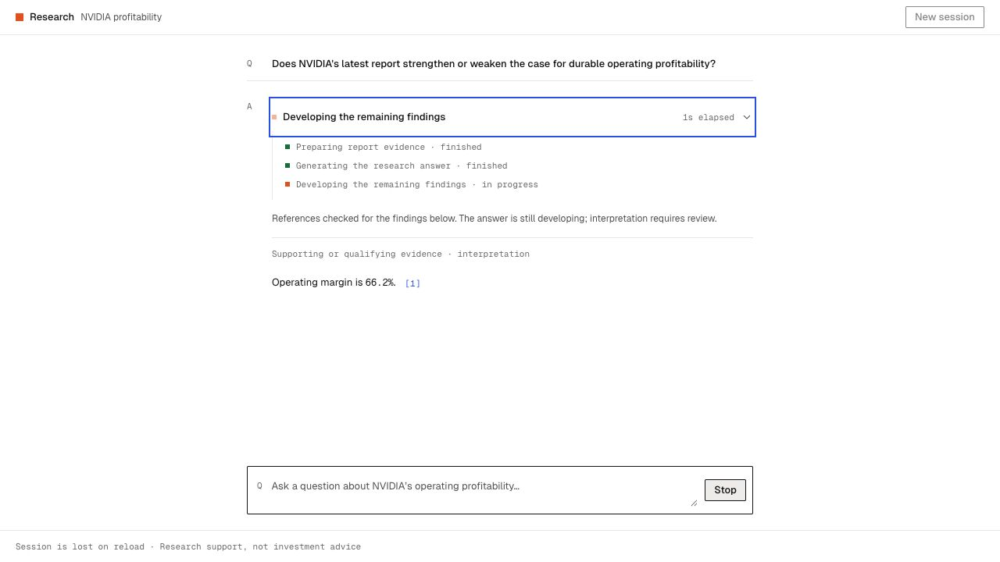

# Compact animated action disclosure

2026-10-12 · D84 · PRD v0.54 · Implemented local presentation iteration; no deployment or pilot release.

## User request and behavior

Replace separate first-attempt heading, completion/time and Show actions rows with one compact clickable current-action/status row and chevron. While running, show the actual current stage and one elapsed timer. At terminal state, show one outcome and total duration. Only retries add an inline attempt number; first-attempt identity remains internal. Existing question/attempt ownership and prior outcomes remain intact.

Clicking the native row button or its chevron expands chronological recorded subtasks, including the explicitly live active step. Completed, failed and stopped steps retain their true states; no per-substep durations duplicate the top-level timer. Remove the standalone Show/Hide actions CTA.

Real L1 label transitions and disclosure/chevron motion use existing A3 opacity/transform, duration/easing and spacing tokens. Reduced-motion preferences disable animation; text/focus/state remain readable. Native Enter/Space, `aria-expanded`, `aria-controls`, visible focus and at least the 44px tokenized hit area are required. Status changes may be announced, while clock ticks stay outside live announcements.

## Scope and compatibility

This supersedes D80/D82's secondary disclosure link and omission of the active step from expanded history. It does not expose private model reasoning, simulate progress or add provider work. No model/source/prompt/output-budget/tool/deadline change. D83 capability negotiation and legacy fallback remain unchanged.

An already-open old page continues using its loaded UI; new disclosure behavior requires loading the updated frontend. Sessions remain memory-only and reload loses them. Restoring the existing authored saved reference is not durable session recovery and uses no model call. Header/index/history and semantic/pilot gates remain deferred.

## Verification

TypeScript and production build pass. This reversible presentation change adds no implementation-mirroring unit tests or paid model trials. Existing backend/protocol contracts remain unchanged; D83's 119-test result is preserved as that checkpoint's evidence.

The no-cost scripted provider exercises the real controller/checker/HTTP and updated client. Browser checks confirm:

- No Show actions/Hide actions control or default Attempt 1 header. One action row uses the current real task label, one elapsed timer and the caret.
- Enter expands during generation. The chronological list includes the active step labeled “in progress,” with earlier real stages marked finished.
- The same native button keeps keyboard focus and its expanded state through final synthesis/checking/completion. The only keyed element is the animated task text; computed animation remains `a3-task-change`.
- Completion freezes one total; expanded history has no additional duration. Space collapses the list.
- At 375px, a click directly on the caret expands the recorded actions. The row measures 44px high; no horizontal page overflow. Explicit list margins are zero, avoiding browser-default spacing. Temporary viewport override is reset.
- `aria-expanded`/`aria-controls` identify the disclosure. Its accessible name and separate status live region contain the task label, excluding elapsed ticks. The list is not live. Existing reduced-motion CSS disables label/pulse/chevron transitions; reduced-motion emulation was not separately exercised.

[Mobile disclosure proof](V2-ACTION-DISCLOSURE-MOBILE-2026-10-12.png)

The normal preview is refreshed and an updated preview is ready in a fresh tab; existing user result tabs remain intact. QA tab/server are removed after verification. No model-quality or latency improvement is claimed from this visual change.

## Remaining limits

This improves the visibility and inspection of real work; it is not a model-latency improvement or proof of user benefit. Existing qualitative citation-coverage, material-omission and E1–E5 practitioner/strong-baseline evaluation remain open. D82/D83 actual model measurements and compatibility evidence remain their original records.
