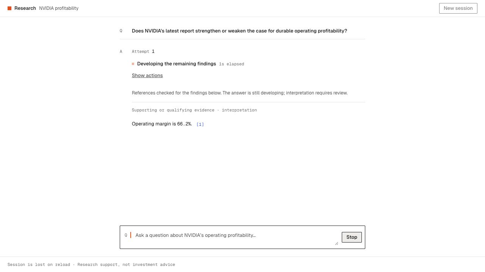

# Incremental checked findings and focused source inspection

2026-10-12 · D82 · PRD v0.52 · Implemented local iteration; no deployment or pilot release.

## Intent and priorities

Helen requests complete validated findings during generation, compact inline citations instead of Open brief/bottom source rows, and animated real task progress in the single top-level status line. Priority order: useful checked content, citation/inspection simplification, then progress motion. This changes presentation and time to first useful checked content without adding model requests or agents.

## Publication contract

The existing request may yield complete structured finding objects server-side before the full draft finishes. Each candidate must pass finding-level shape, fact-ID, source-quote, numerical-placeholder and sensitive-output checks before any browser event. Code owns numbers and provenance. No incomplete object, raw delta or private reasoning is published. Events are owned by the validated session/turn/revision and current provider request.

During generation, the UI labels passing findings as a developing answer with mechanical reference checks. Final full-draft dependency checking remains authoritative and reconciles/removes provisional findings before a completed artifact. Recovery, Stop, failure and obsolete identities clear provisional content; completed earlier answers remain owned by their original attempts. An unfinished attempt is not added to conversation history as evidence.

## Presentation contract

The complete answer and calculation/cash-bridge disclosures remain in the thread. Remove Open brief, the Brief inspection tab/full brief pane and standalone bottom source rows. Compact inline `[1]`/`[2]` citations expose actual report labels/dates and open source inspection. Exact quoted passages remain inspectable; fact-only findings use report/lineage provenance without an invented quote. Actual stage-label changes animate with existing A3 tokens, reduced-motion behavior and one timer. No fake progress stages or timer announcements.

## Verification

- 115 automated tests pass, including the actual array-close milestone and inactive/late callback guards. TypeScript and production build pass.
- Parser/controller/HTTP checks cover character/escape and SSE byte boundaries; top-level classification; incomplete objects; mismatched/foreign quotes and facts; sensitive output, free quantities and markup; duplicate IDs/root keys; divergent terminal payloads; tool/format recovery reset; Stop/deadline/late callbacks; session/turn/revision ownership; and final reconciliation.
- Scripted browser proof shows a whole checked finding while Stop remains active, with one elapsed timer. Invalid candidate `99%` never appears. Complete results replace developing findings, retain selected numeric comparisons, and resolve valid numerical placeholders in row implications.
- No Open brief CTA, Brief source tab or bottom SourceList appears. Inline controls expose report/date and measure 44×44; a qualitative citation opens its actual highlighted passage. Calculation and complete cash-bridge disclosures remain in the thread.
- Narrow (375px) source inspection → Stop clears developing findings, returns to the thread, preserves the earlier completed answer and restores focus to the enabled composer. No horizontal page overflow. A retry stays under the same question; failed final dependency checking clears its developing content, leaving only the earlier completed answer. Temporary viewport override is reset.
- The active task advances to remaining findings after the first checked finding, then to writing the takeaway when the actual findings array closes. These are observed milestones rather than estimated model reasoning. The final scripted browser run records exactly one preparing → generating → remaining findings → writing takeaway → checking sequence, with one timer. Completion returns keyboard focus from the removed Stop control to the enabled composer. Actual top-level task changes animate using `--dur`/`--ease`/`--space-1`; the computed label animation is 0.12s. Existing reduced-motion CSS disables animations and transitions; reduced-motion emulation was not independently exercised. Timer text remains outside the status live region.

### Capped live E1 measurements

Two fixed public NVIDIA trials used one model call and zero tools each, with $0.162445 total estimated/reserved usage. See the adjacent JSON record for separate raw-text, first-finding and full-completion timing.

| Version | First checked finding | Later findings | Full completion | Outcome |
| --- | --- | --- | --- | --- |
| Prompt v6 / schema v4 | 7.291s | 12.424s; 16.096s | 20.026s | No reference drops, but a finding ended mid-sentence at the 800-character wire bound; rejected as a complete-prose example. |
| Prompt v7 / schema v5 | 7.571s | 10.766s; 13.592s | 17.062s | All three findings complete, no resets or reference drops. |

The first trial caused two additional checks: shared progressive/final verification now rejects visibly unfinished finding prose, and takeaway numerical placeholders must belong to its explicitly linked surviving findings. The prompt requests concise complete sentences/caveats; the finding allowance is 1,200 characters to accommodate long fact IDs. Total output remains 3,072 tokens and the provider/tool/deadline budgets are unchanged. A punctuation check catches obvious truncation; it does not prove semantic completeness. No draft is silently repaired.

One accepted live trial is evidence that the path works for this question, not p95, a multi-case reliability estimate or a semantic-quality pass. In particular, the rejected trial's baseline gross-margin quote did not support all its outlook/financing statements. The retest contains more relevant quotes, but clause coverage, material omissions and usefulness still require human evaluation.

## Remaining limits

Mechanical checks do not establish semantic support for every interpretation clause. Existing qualitative citation-coverage and material-omission review remain open. Source scope is still the frozen NVDA SEC pair; no daily news/prices, broad issuer coverage, extra agent or durable history. Header/index changes remain deferred. E1–E5 practitioner/strong-baseline comparison and pilot/release gates remain pending.
