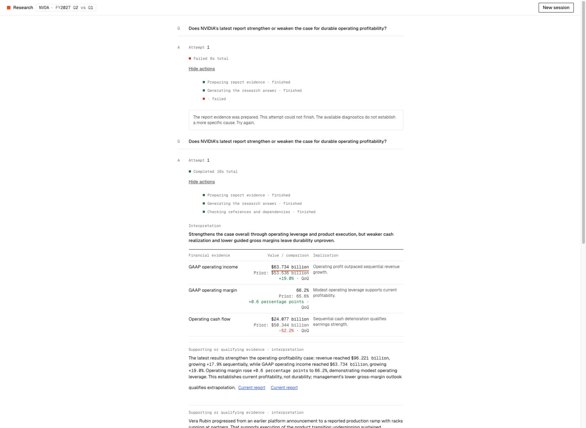

# Progressive stream compatibility regression

2026-10-12 · D83 · PRD v0.53 · Corrective local iteration; no deployment or pilot release.

## Observed failure and attribution

Helen reports the next preview request failed after about six seconds. Browser inspection confirms the already-open page still uses the older `c9d27e1` client. Its parser treats every non-stage event as a final result and accesses `event.result.identity`. D82 adds complete checked finding events that have no `result` member, causing that old parser to fail. The older page also cannot label the new stage names, leaving blank progress copy.

The corresponding current prompt-v7 provider trace delivers the first mechanically checked finding at 6.152s and completes at 15.262s, with three findings and no reference drops. These timings are one observed run; they do not establish p95 or production reliability. The user-visible failure is a protocol incompatibility between an already-open older frontend and newer backend, not an incomplete model response or failed reference check. Preserve [D82 measurements](V2-PROGRESSIVE-FINDINGS-2026-10-12.md) as distinct trials.

The old client stops displaying the response after its processing failure; a completed server trace shows this failed browser view did not cancel the corresponding provider stream. Prevent paid work continuing unnoticed on future processing failures.

## Corrective contract

- Current clients explicitly request `X-Research-Protocol: findings-v1`.
- Only that recognized capability enables complete finding/reset events and the newer generation milestones.
- Absent or unknown capability receives the original stage/result events with only legacy stage labels. Model/controller/final checks still operate on the same research task.
- Current clients dispatch recognized event types explicitly and safely ignore unknown types; a future event must not be assumed to contain `result.identity`.
- Parsing/processing failure cancels the reader, aborts request/provider work, clears provisional content and records one honest failed attempt. Keep validated session/turn/revision, Stop and late-result gates intact.

Backward-compatible server responses allow an already-open older page to finish without forcing reload. This is distinct from delivering new progressive UI code to an old page: users need to reload to obtain changed frontend behavior, and this prototype's memory-only session is lost on reload. Do not promise saved history.

## Verification

- **119 tests pass**, with TypeScript and production build passing. Coverage includes the exact old consumer identity expression, absent/unknown protocol fallbacks, recognized progressive events/reset, original stage vocabulary, unknown/malformed event dispatch, and sanitized retryable processing errors that preserve input/config blocks.
- The **same still-open legacy tab**, without refresh, reran the fixed public profitability question. It completed in **16.766s** with one provider call, zero tools, `result-v1`, no reference drops and no extended findings published. The prior failed turn remains visible as history. This is one real model/browser trial, not a latency guarantee or semantic-quality pass.
- The updated client/harness forwards `findings-v1`: a whole checked finding appeared at the scripted provider's first milestone; the developing and final-synthesis stages were recorded; the final checked answer replaced it at the scripted six-second completion. This verifies transport/UI behavior without model spending.
- A separate injected malformed NDJSON frame after the first checked finding caused an honest failed turn with usable Retry. Provisional findings and final artifacts were absent, private exception text was not displayed, and focus returned to the composer. The scripted provider recorded `scripted_provider_aborted` before its planned completion, confirming browser → request → provider cancellation rather than only a UI error.
- The existing saved-reference preview was refreshed to the current client and its same authored reference restored without a model call. The legacy tab's live answer was preserved. Temporary QA tab/server were removed; the normal preview remains running.

The adjacent JSON records the two observed pre-fix client failures and the real legacy-tab retest's content-free provider/check diagnostics. The compatibility change did not alter the model, prompt, schema, source packet or generation budget.

[Original six-second failure](V2-STREAM-COMPATIBILITY-FAILURE-2026-10-12.png) · [Updated progressive client, scripted test](V2-STREAM-COMPATIBILITY-PROGRESSIVE-2026-10-12.png)

## Scope and remaining limits

No added model stage, per-turn provider call, agent, source, output cap, tool round or deadline. Model/prompt and evidence/checking scope are unchanged. This repairs transport/version compatibility rather than establishing qualitative answer quality. Existing semantic citation coverage, E1–E5 practitioner/strong-baseline comparison and pilot gates remain open; header/index and durable history remain deferred.
