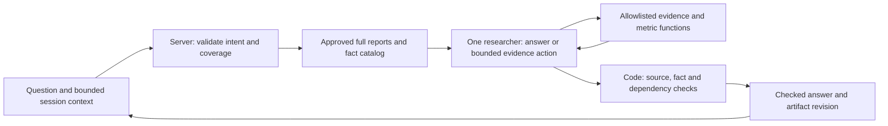

# Smallest viable V2 technical plan

2026-10-12 · Historical D61 proposal, narrowed by the D64 launch scope approved under D65. D69 [architecture/autonomy/control specification](ARCHITECTURE-AND-SAFETY.md) clarifies the current boundaries and diagram. Work within the approved scope is authorized; broader alternatives below are not blanket approval. Read [decision memo](V1-V2-PRODUCT-DECISION-MEMO.md) and [audit](V1-AUDIT.md) first.

## Recommended scope and architecture

One NVIDIA research session, open-ended questions about the existing two complete releases, a checked question-specific answer, a contextual follow-up, and a reusable artifact. Optional prompts/settings assist discovery; no required investor profile. Start with operating profitability, cash conversion and reported execution risks. Retain source dates and coverage limits. Analyst thesis analysis is the primary V2 task; client explanation is a separate later task.

The diagram is a proposed design, not an implemented agent loop. A question can use the supplied packet directly. Do not add a mandatory planner → researcher call sequence when source scope is already known. Optional tool use must fill an actual gap, such as selecting source-backed metric calculations; no tool call purely to demonstrate activity.

Keep the existing model/provider for the initial comparison. Re-evaluate effort and compact response size with the new question tasks; neither high nor the local low-effort candidate is established as best for V2. Direct Responses API remains sufficient; no framework migration or new provider required. Function calls are requests for application code to execute approved actions, not source acquisition automatically provided by the model. [Official function-calling guide](https://developers.openai.com/api/docs/guides/function-calling).

## Contracts and state

**Research request:** question text, supported issuer/source scope, optional explicitly supplied context, bounded prior turns and artifact revision reference. Proposed ceilings: 2,000 characters per question, last six turns plus a bounded artifact; validate total request/context size before calling the model. Do not keep the current 2KB envelope for all history. Avoid inferring an investor's goal/risk/holding period when the question does not require them.

**Answer:** direct answer to the objective; findings with stable IDs, facts and source references; supporting/qualifying evidence; selected financial rows; unanswered questions; scope limits; completion status. A rationale rating and profile_fields are not required for arbitrary company questions. Preserve distinguishing reported facts, outlook and interpretation. Model never invents calculations or source IDs.

**Artifact:** source/config version, question/turn ID, revision, linked checked findings/rows, unresolved items and change history within the session. Follow-up can add, qualify or supersede a finding without silently presenting a conflicting earlier answer as current. Material dependency failure marks the answer partial/failed; useful checked content remains inspectable. A source-limited unresolved answer differs from a generation/checking failure.

**Session recommendation:** active browser session state only for first release; no database, refresh recovery or long-term memory promise. A follow-up sends bounded conversation context to the server. Client history and previous model prose are untrusted context, not financial evidence: every new material claim is checked against the server-owned packet. Revalidate source/fact references; ignore client-supplied source bodies. Cross-session persistence needs a later retention/storage decision.

**Free text:** public-company questions only initially; tell users not to enter client identity/account details. No raw prompt/history logging by default. Basic safeguards are not guaranteed anonymization. D69 records the public-company boundary and synthetic privacy/config checks; the old bounded-input privacy assertion does not apply. Actual client-data use remains outside this MVP.

## Reuse and modifications

| Component | Plan |
|---|---|
| SEC packet/source hashes and preparation | Reuse frozen approved full releases and fiscal lineage; no runtime SEC scraping or new login-dependent sources |
| Financial selection/arithmetic | Reuse compatible-period facts; add GAAP operating margin = operating income / revenue and QoQ percentage-point change in code, with references to numerator/denominator facts; reject incompatible periods/zero denominator. Do not conflate operating and gross margin |
| Source/fact/dependency checks | Extract reusable primitives; retain rejection behavior. Replace forced rationale/profile requirements; keep conservative numeric rendering initially. Broader quantitative quotations need separate verification work |
| Paired response candidate | Reuse evidence-first/stable-reference design as a starting point; new generic schema/prompt, not an opaque wrapper mapping questions into preset labels |
| API route/provider | Preserve Preview/access/origin/secrets/cancellation; add research-question/history validation, budgets and turn/revision identifiers |
| UI | Thread composer and short assistant answer; artifact with question-specific summary, selected metrics, evidence and open questions. Wide screens show thread + artifact; mobile switches between them. Keep compact typography, metric columns and evidence disclosures |
| Event stream | Reuse NDJSON for honest state/error/result events in P0; add independent checked artifact patches in P1 |

Proposed optional actions: `read_approved_evidence` for allowlisted full-period evidence/paragraph IDs and `get_checked_metrics` for eligible facts/derived operating margins. Server executes these functions, validates arguments and applies their calculation rules. No arbitrary URLs, shell, web search or arbitrary formulas. Full source context remains accessible, rather than short keyword matches alone.

D71: include a fixed code-owned operating-cash-flow bridge in `get_checked_metrics`, prepared from the existing releases' quarter columns, with signs/units/fiscal headers/lineage and all-row reconciliation. [Offline reference](../../../evals/V2-CASH-BRIDGE-REFERENCE.json) is not runtime data yet. Accounting contributors can be explained; their business causes remain separately bounded. No new source/tool/model round. See [build-ready contracts](BUILD-READY.md).

Current D64/D69 budget: at most one tool round, two tool executions and two provider calls per user turn; this supersedes the earlier three-call proposal. Reuse source context across turns where practical. Preserve a wall-clock deadline and cancellation. Duplicate/no-progress action ends with an explicit limit. No automatic paid repair/retry; no process-local map relied on as durable session storage. Measure overhead before enabling a tool path that a direct answer can handle.

## Implementation sequence, after approval

1. Freeze supported tasks and expected evidence before tuning the new prompt. Confirm target/source/session policy and operating-margin definition.
2. Add public-question/session/answer contracts and code-owned operating-margin facts with fiscal provenance. Refactor check primitives; regress existing invalid-reference and unsupported-number failures.
3. Build a server-only question-specific answer path; permit bounded approved actions when necessary. Carry bounded context into a follow-up; check each output against authoritative sources. Start without a mandatory separate planner call.
4. Build the thread + artifact interaction using saved labeled outputs, then wire dynamic server runs. Preserve reviewed content on partial failure, explicit stop/retry and source coverage. A redirect in P0 stops the current run and starts a new turn; seamless mid-generation steering is deferred.
5. Run the task, follow-up, error and source-limit evaluations. Evaluate model effort/latency against quality; deploy a separate protected Preview and tag only after the gate.
6. P1: independently checkable findings/patches, selective clarification and richer tool/progress visibility. Publish completed checked units; raw JSON/token fragments stay out of the verified artifact. A later unit can qualify an earlier one with a visible revision. Progress is concise task/action summaries, not hidden reasoning.

Provider streaming is possible, but absent from current code. The API streams response events; it does not certify the claims contained in them. Monolithic JSON parsing/verifying must change before useful incremental findings can be safely published. [Official streaming guide](https://developers.openai.com/api/docs/guides/streaming-responses).

## Acceptance criteria and failure cases

- A user asks a supported question without choosing a profile; the answer addresses that question and opens exact source evidence/financial calculation lineage.
- A contextual follow-up references prior work without restarting setup. No silent switch of company, period, objective or accounting definition.
- Operating-margin numbers and changes come from checked code with the correct fiscal periods. No unsupported gross-margin numbers or calculations from model prose.
- Same source pair is used for comparison. Out-of-scope issuer, 10-K, current-market and unsupported metric requests give a useful coverage limit, not fabricated retrieval.
- Missing/unnecessary context is not turned into an obligatory questionnaire. Essential unknowns block only dependent claims; unrelated work may proceed with stated scope.
- Malformed references, source instruction injection, contradictory follow-ups, failed tools, partial outputs, cancellation, deadline and loop budget retain checked work and yield honest state. Prior user/model text cannot become a source of facts.
- Evaluate primary task completion, citation entailment and first useful checked insight; total reviewed time, interactions/corrections, material omissions and cost remain recorded. Proposed initial gate: three attempts on each supported fixture, include all failures, manually review material claims; small-sample success is not production proof.

## Pressure test

Conversation can be worse for repeated standardized tasks or analysts who do not know what to ask: keep suggested prompts and optional controls. Free text may hide intent misinterpretation: show the working question and source dates, allow correction. More agents/calls, long history and repeated source analysis can increase actual latency. Early findings can anchor users before counterevidence is found: keep material limitations visible and revise explicitly. Fluently cited text can still misread a passage: evaluate entailment/omissions, not only matching.

NVIDIA-only evidence limits broad exploratory value. If users' real tasks require calls/10-Ks/peers/news, log the missing evidence and revisit scope; do not disguise a general analyst research claim around a narrowly prepared source pair. The minimal release tests interaction and continuation, not the entire financial research market.
