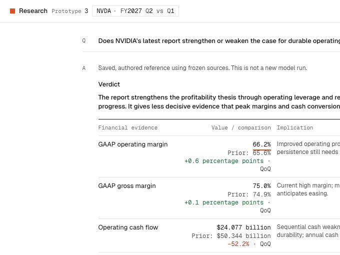

# D87 reported-first evidence: V3 runtime acceptance

2026-10-12 · D88 implementation of Helen's D87 policy · V3 only.

## Outcome

V3 uses matching source-reported figures/ratios/growth directly and preserves their reporting precision. The existing GAAP summary gives revenue YoY +106%, operating-income YoY +124%, operating-expense YoY +55%, and gross-margin QoQ +0.1 percentage points; these replace the prior candidate's more precise routine recalculations. Data Center reported growth is also eligible. Operating-margin ratios/changes, cash growth, concentration and cash-bridge differences remain calculated because matching measures are missing from this bounded report catalog.

Reported provenance retains paragraph, fiscal/comparison column, original token and unit scale. Derived provenance retains formula, input IDs and precision note. Quarterly cash amounts come from the existing release tables rather than requiring the structured-companyfacts/legacy fact array. No extra sources, login, network retrieval, model/effort/tool/deadline/output-budget changes.

## Acceptance evidence

**141 tests pass**, with 13 new D87 cases plus revised V3 expectations for the intentional selection/provenance change. Typecheck and production build pass. Initial outdated assertions for recalculated rates/full V2 fact-object equality and fatal historical conflicts were replaced with the new required behavior and explicit withholding/visibility tests. A test's optional-output typing error was fixed before the final successful build.

| Criterion | Observed check |
|---|---|
| Reuse matching reported metrics | Exact integer reported growth and decimal gross-margin precision, sign/percentage-point unit and source paragraph/column survive extraction |
| Calculate only missing comparisons | Missing-rate fixture uses code formula/inputs; absent operating-margin ratio and cash growth retain explicit lineage |
| Reject incompatible extraction | Wrong source period, fiscal context, unit, GAAP or column structure fails before provider dispatch |
| Avoid a required redundant second format | Removing legacy fact/companyfacts and cached comparison arrays still yields reported values from the existing release pair |
| Preserve rounding | Compatible cached 105.9% does not replace the reported 106%; reported 75.0%/0.1pp keep precision |
| Surface actual discrepancies | Synthetic cached 90% vs reported 106% is exposed, withheld and not averaged; unrelated values remain eligible |
| Match cached definitions/baselines | Different metric/baseline comparisons do not displace the matching reported rate |
| Preserve dependencies | Conflicting historical values withhold the baseline and its dependent ratios/comparisons; discarded comparisons cannot support findings or synthesis |
| Prevent quotation bypass | Exact quotation from a disputed financial row cannot reintroduce a withheld comparison; unrelated eligible values can still be used via checked fact IDs |
| Keep issues visible through the flow | Progressive and final events carry discrepancies; partial and failed-takeaway states show them and retain earlier checked work |

Browser on the authored reference confirms +106% / +55% / +124% and the calculated +5.4pp operating-margin change in expanded analysis. “Inspect evidence basis” labels reported vs calculated, source units/columns and explicit fiscal periods/baselines, with formulas and input values for calculations. A separate no-spend synthetic harness confirms a visible conflict notice, keyboard-expandable 106% vs 90% detail, partial outcome, and retained discrepancy/prior outputs after a failed headline. The canonical report files are unchanged. Reloading after the final build resolved a stale preview-bundle load during testing; do not count that navigation failure as a model error.

## Limits and versioning

Facts `v3-reported-first-1`; prompt `v3-thesis-research-2`; generated-answer shape `v3-thesis-schema-1`; source hash and test metadata in the adjacent JSON record. New public debug captures identify preparation version; replay rejects a different preparation version. Prior candidate records remain intact under `prototype-3-candidate-1`, and V2/source/lockfile hashes match the baseline manifest.

No paid model calls in this migration. These are source/extraction/dependency/browser acceptance checks, not certification of issuer accounts, semantic analysis, speed improvement or pilot readiness. The first live V3 generation and subsequent human E1–E5 grading remain pending following the earlier provider-reported credit exhaustion.

