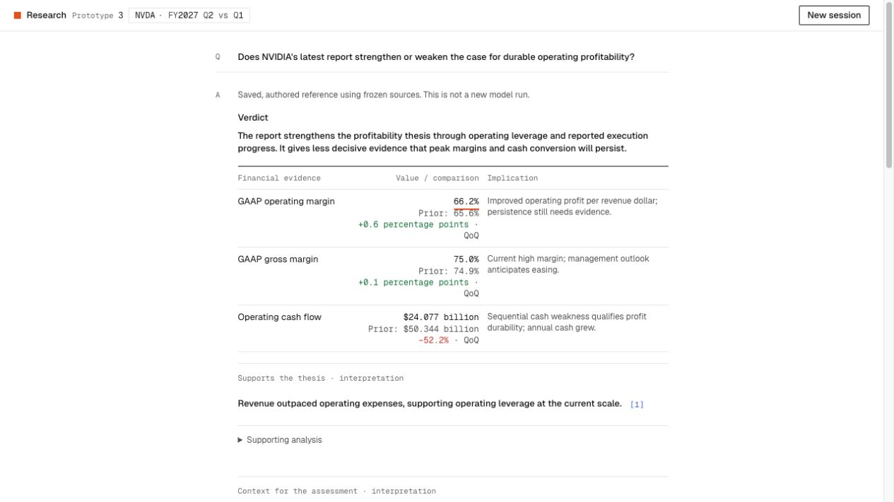

# Prototype 3 first candidate results

2026-10-12 · D86 · local implementation, no deployment or semantic/pilot pass.

## Implementation evidence

- Full deterministic suite: **128 tests pass**, including unchanged V2 tests and nine V3 tests. TypeScript and production build pass. A test-harness Buffer typing failure was corrected before the successful build; no test failure is concealed as a passed attempt.
- New tests exercise report-owned expense/gross-margin/concentration/guidance facts, preservation of V2 facts, fiscal/unit/GAAP/prior-row corruption, both summary/detail numerical/source checks, dropped synthesis dependencies, six-finding framing/controller, checked-finding-before-result HTTP order, actual wire-schema validation, bounded formatting recovery, credit-error sanitization and authored reference provenance.
- These checks establish mechanics, not material claim support, explanatory usefulness, real-model injection resistance or deployed security/resource gates.
- The V3 UI retains A3 tokens/primitives, one highlighted fact, in-thread completion and explicit source inspection. Short qualified summaries expand via native keyboard-accessible disclosures. Authored reference uses real prepared facts and is labeled as authored; it is not a V3 model output.

## Live public E1 attempts

| Attempt | First checked finding | Full duration | Outcome |
|---|---|---|---|
| V2 local sandbox attempt | none | 0.020s | No HTTP response; local execution/network failure, not an answer-quality result. Preserved. |
| V2 live baseline, prompt v7/schema v5 | 7.471s | 17.173s | Complete; three findings, one request/zero tools, no drops. No new human grade inferred. |
| V3 initial candidate | none | 0.941s | Provider error before text; no draft/output. |
| V3 public-fixture diagnostic | none | 1.134s | Provider explicitly returns `credit_balance_exhausted` / `insufficient_quota`; no draft/output. |

[Trial metadata](TRIALS-2026-10-12.json) preserves source hash/configuration, all attempts, provider usage/unknowns and content-free stream diagnostics. Full public-only captures remain in ignored `.research-runs/`. V2 reports 28,783 input / 942 output tokens, including 67 reasoning tokens; its existing ledger estimate is $0.0813775. Failed-call usage is unknown; ledger reservations are not observed billed amounts. Do not interpret the V3 failures as weak reasoning, low latency or a schema rejection. Stop paid trials after the diagnosed credit error. V3 now maps quota events to a specific sanitized non-retryable input/config block, with authored reference access and prior work preserved.

## Browser checks

The first authored-reference check confirms Verdict before evidence, collapsed short summaries, keyboard expansion/collapse and source inspection. The scripted test confirms a checked finding appears before final verdict, developing interpretation is labeled, completion stays in the thread, exactly one total remains, and expansion persists. It revealed keyboard focus loss when the completed component replaced the provisional one; V3 now restores focus to the surviving disclosure, falling back to the composer if absent. Final retest confirms the expanded disclosure and keyboard focus survive completion. On a failed follow-up, provisional findings clear, the earlier checked answer remains, and the composer is focused. At 375px, the page has no horizontal overflow; source inspection keeps Stop reachable. Stop aborts the scripted provider (attempt 4), returns to the thread, clears provisional content and retains the earlier answer/disclosure. Temporary viewport override is reset, QA tab/server closed. The final V3 preview remains open on its authored reference. No scripted result is a live V3 quality score.

## Quality and next gate

The supplied ChatGPT answer remains an unmatched web-enabled baseline. Preparation catches a numerical calibration issue: using reported GAAP operating income/revenue, matched-year operating margins are approximately 60.8% and 66.2%, with a difference rounding to 5.4 percentage points; the supplied answer's 60.9% / 5.3pp is not the checked result. Preserve ChatGPT's useful structure/depth without treating it as reference truth.

Next: usable credits for the same fixed public V3 E1 turn; human claim-by-claim review of support, mechanisms, relative evidence weight, omissions and synthesis, then repeated E1–E5/needed controls. The [evaluation contract](EVALS.md) records held-out cases, failure retention, analyst rework and latency/cost measurements. Higher effort and additional source coverage are separate later experiments. Memory-only history, header index and protected deployment gates remain unresolved.

